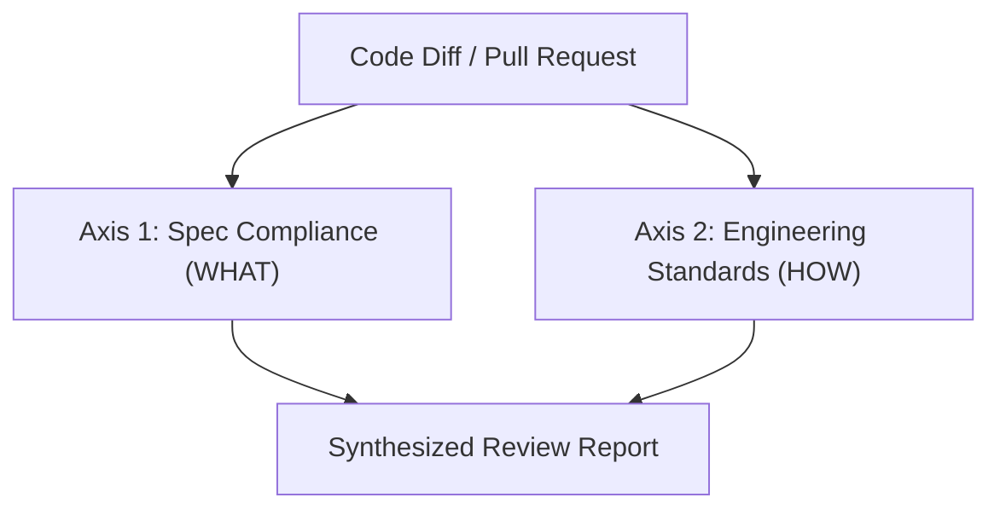

# Master Code Review & Quality Assurance Framework

A comprehensive, unified code review methodology synthesizing automated static analysis, two-axis human/AI inspection, security hardening, performance auditing, architectural smell detection, and review communication etiquette.

---

## 1. Two-Axis Review Architecture

Effective code review evaluates changes across two independent, non-overlapping axes:



### Axis 1: Spec & Intent Compliance (WHAT)
* Does the code faithfully and completely implement the requirements from the user request, issue, or PRD?
* Are all acceptance criteria met?
* Were unstated requirements or edge cases silently ignored or mishandled?
* Did the change introduce unauthorized scope creep or speculative features (YAGNI)?

### Axis 2: Engineering Standards & Quality (HOW)
* Does the code adhere to language conventions, architectural guidelines, and codebase patterns?
* Is it robust, secure, performant, readable, and properly tested?
* Does it introduce technical debt, cyclomatic complexity, or security vulnerabilities?

---

## 2. Multi-Tier Review Checklist

### A. Correctness & Logic
- [ ] **Contract Fulfillment:** Functions return expected types and adhere to interface definitions.
- [ ] **Boundary Conditions:** Loops, slices, and index operations handle `0`, `1`, `N-1`, and empty states.
- [ ] **Nullability & Optionals:** `null`, `undefined`, and `None` safely guarded without runtime panics.
- [ ] **Error Propagation:** Errors are either properly handled or propagated; exceptions are never swallowed silently.
- [ ] **Concurrency & Race Conditions:** Shared state guarded by locks, atomics, or actor boundaries.
- [ ] **Async / Promise Safety:** All async calls awaited or properly chained; unhandled rejections prevented.

### B. Security & Vulnerability Defense (OWASP)
- [ ] **Input Sanitization:** All user inputs validated against strict schemas (e.g., Zod, Pydantic) at the API boundary.
- [ ] **Injection Prevention:** Parameterized SQL queries used exclusively; no raw string interpolation in queries, shell commands, or HTML templates.
- [ ] **Authorization & IDOR (BOLA):** Object-level permissions verified (can User A access Object B belonging to Tenant C?).
- [ ] **Secrets & Tokens:** Zero hardcoded API keys, private keys, passwords, or tokens in source code or commit history.
- [ ] **Cryptographic Hygiene:** Modern algorithms only (AES-GCM, Argon2, bcrypt); no MD5 or SHA1 for passwords.

### C. Performance & Resource Management
- [ ] **Query Efficiency:** No N+1 database queries. Joins, eager loading, or batch fetching used where appropriate.
- [ ] **Index Coverage:** Queries filter and sort on indexed columns.
- [ ] **Memory & Handles:** File descriptors, database connections, streams, and event listeners properly closed/disposed.
- [ ] **Complexity Bounds:** Algorithmic complexity is within acceptable bounds ($O(n)$ or $O(n \log n)$ preferred over $O(n^2)$).
- [ ] **Caching:** Expensive computations or repeated remote fetches properly cached with explicit TTL and eviction policies.

### D. Architecture, Cohesion & Maintainability
- [ ] **Single Responsibility Principle (SRP):** Classes and functions do one thing with high cohesion.
- [ ] **Minimal Blast Radius:** Changes are localized; modification does not cascade across unrelated modules.
- [ ] **DRY vs YAGNI Balance:** Code is not duplicated, but abstractions are not created prematurely for hypothetical use cases.
- [ ] **Configuration Isolation:** Environment-specific values (URLs, ports, timeouts) stored in environment configs, not hardcoded.

### E. Testing & Verification
- [ ] **Coverage Quality:** Unit tests verify business logic; integration tests verify component boundaries.
- [ ] **Negative Testing:** Tests assert failure states, bad inputs, timeouts, and network disconnects.
- [ ] **Mock Hygiene:** Mocks are minimal; test asserts outcomes, not internal implementation trivia.
- [ ] **Deterministic Execution:** Zero flaky sleeps (`setTimeout`); condition-based polling used for async workflows.

---

## 3. AI & LLM Code Generation Inspection

When reviewing code generated by AI models (Copilot, Claude, Gemini, ChatGPT), apply targeted verification against common AI failure modes:

1. **Hallucinated APIs:** Verify every imported library function, class, or method actually exists in the installed package version.
2. **Context Amnesia:** Check that changes don't silently overwrite or ignore existing repository conventions (e.g. error handling wrappers, custom loggers).
3. **Over-Defensive Boilerplate:** Strip out unnecessary layers of null-checks or duplicate try/catch blocks that obscure the core logic.
4. **Subtle Off-By-One Logic:** Scrutinize range bounds (`<=` vs `<`, index calculations, pagination offsets).

---

## 4. Code Smells & Refactoring Triggers

| Code Smell | Manifestation | Required Action |
| :--- | :--- | :--- |
| **Long Method** | Function > 30 lines doing multiple operations | Extract sub-functions with descriptive names. |
| **God Class** | Class with dozens of fields and unrelated methods | Split into focused domain services or value objects. |
| **Primitive Obsession** | Raw strings/integers passed for domain concepts (e.g., currency, emails) | Encapsulate in Value Objects with internal validation. |
| **Feature Envy** | Method in Class A repeatedly accesses data in Class B | Move the method to Class B where the data lives. |
| **Speculative Generality** | Complex generic patterns or plugin interfaces for a single implementation | Simplify to direct, concrete implementation (YAGNI). |

---

## 5. Review Etiquette & Feedback Workflows

### A. Submitting a Pull Request (Requesting Review)
* **Atomic Size:** Keep PRs under 400 lines of diff whenever possible. Large changes must be broken into stacked PRs.
* **Contextual Description:**
  - **What:** Brief summary of changes.
  - **Why:** Link to user request, issue, or ticket.
  - **How:** High-level architectural approach.
  - **Verification:** Proof that tests passed, logs, or before/after screenshots.
* **Self-Review First:** Always review your own git diff before assigning peers or agents.

### B. Receiving and Responding to Review Comments
* **The Verification Protocol:**
  - Never blindly say "Fixed!" without verifying the change against the codebase.
  - If a reviewer suggests a change, run the test suite to confirm it does not break existing contracts.
* **Pushback Criteria:**
  - Push back politely with concrete evidence if a suggestion:
    - Violates project architecture or established patterns.
    - Adds unnecessary complexity or over-engineering (YAGNI).
    - Degrades performance or causes regression.
* **Forbidden Responses:**
  - ❌ *"You're right, my bad! Fixing now."* (Knee-jerk compliance without verification).
  - ❌ Silent ignore of reviewer comments.

---

## 6. Review Severity Tiers & Action Priority

| Severity | Definition | Action Required |
| :--- | :--- | :--- |
| 🔴 **CRITICAL** | Security flaw, data corruption, hard crash, breaking public API | **Blocker.** Must be fixed before any merge. |
| 🟠 **HIGH** | Functional defect, missing edge case handling, performance bottleneck | **Blocker.** Must be resolved or explicitly deferred with a ticket. |
| 🟡 **MEDIUM** | Code smell, suboptimal abstraction, missing test coverage | Should be addressed in current PR unless tight deadline. |
| 🟢 **LOW / NIT** | Style preference, naming tweak, minor comment formatting | Optional. Author discretion; never blocks PR. |

---

## 7. Automated Review Tooling (CodeRabbit & Linters)

When running automated reviewers:
```bash
# 1. Run local linters and type checkers first
npm run lint && npm run typecheck
flake8 src/ && mypy src/

# 2. Inspect git diff against base branch
git diff origin/main...HEAD

# 3. Check for leftover debugging artifacts
git diff | grep -E "console\.log|print\(|debugger|breakpoint\(\)"
```
