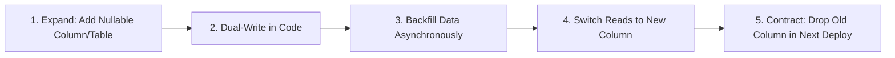

# Master Database Architecture, SQL Optimization & Migrations

A comprehensive, unified discipline synthesizing database design, indexing strategies, query plan analysis, concurrency control, deadlock prevention, and production zero-downtime migrations.

---

## 1. Storage Engine & Technology Selection

| Category | Primary Technologies | Optimal Workloads | Antipatterns |
| :--- | :--- | :--- | :--- |
| **Relational (RDBMS)** | PostgreSQL, MySQL | ACID transactions, financial ledgers, complex relations | Storing unbounded raw sensor events, deep nested document trees |
| **Columnar (OLAP)** | ClickHouse, DuckDB, BigQuery | Petabyte analytics, aggregations, time-series metrics | High-frequency point `UPDATE` or `DELETE` operations |
| **Document (NoSQL)** | MongoDB, DynamoDB | Polymorphic catalogs, rapid prototyping, decoupled docs | Multi-table relational joins, strict ACID across collections |
| **In-Memory / Cache** | Redis, Dragonfly | Sub-millisecond sessions, pub/sub, rate-limit counters | Primary persistent source of truth for critical enterprise data |

---

## 2. Advanced Indexing Strategies

### The B-Tree Index & Leftmost Prefix Rule
* Composite Index `CREATE INDEX idx_user_status_date ON users (tenant_id, status, created_at)`:
  - ✅ Fast: `WHERE tenant_id = 5 AND status = 'ACTIVE' AND created_at > ...`
  - ✅ Fast: `WHERE tenant_id = 5 AND status = 'ACTIVE'`
  - ✅ Fast: `WHERE tenant_id = 5`
  - ❌ Cannot use index: `WHERE status = 'ACTIVE'` (violates leftmost prefix rule).

### Specialized Index Types
* **Covering Index (`INCLUDE`):**
  ```sql
  CREATE INDEX idx_orders_user_inc ON orders (user_id) INCLUDE (total_amount, status);
  ```
  Resolves query using **Index Only Scan** without reading heap tables.
* **Partial / Filtered Index:**
  ```sql
  CREATE INDEX idx_active_subscriptions ON subscriptions (user_id) WHERE status = 'ACTIVE';
  ```
  Saves 90% index size by only indexing rows matching predicate.
* **GIN (Generalized Inverted Index):** Mandatory for JSONB (`data @> '{"role": "admin"}'`) and full-text search.

---

## 3. Query Plan Analysis & Optimization (`EXPLAIN ANALYZE`)

Always run `EXPLAIN (ANALYZE, BUFFERS, VERBOSE)` when tuning slow queries:

```sql
EXPLAIN (ANALYZE, BUFFERS)
SELECT u.id, u.email, count(o.id)
FROM users u
JOIN orders o ON u.id = o.user_id
WHERE u.created_at >= '2026-01-01'
GROUP BY u.id, u.email;
```

### Scan & Join Hierarchy (Best to Worst)
* **Scans:**
  1. `Index Only Scan` (Best: answers from index alone, zero heap page reads).
  2. `Index Scan` (Reads index, then fetches specific matching rows from heap).
  3. `Bitmap Index Scan` + `Bitmap Heap Scan` (Gathers row pointers from index, sorts by disk block, batches reads).
  4. `Seq Scan` (Table Scan) (Worst for OLTP: reads every disk page in table sequentially).
* **Joins:**
  - `Nested Loop`: Fast when outer set is small and inner table is indexed.
  - `Hash Join`: In-memory hash table of smaller table; fast for large unindexed joins. Watch for disk spills if `work_mem` is exceeded.
  - `Merge Join`: Highly efficient when both inputs are pre-sorted by join key.

---

## 4. Concurrency, Locks & Deadlock Elimination

### Deadlock Prevention Rule
> [!IMPORTANT]
> **Enforce Uniform Lock Acquisition Order:**
> If Transaction A locks Record 1 then Record 2, and Transaction B locks Record 2 then Record 1, a **deadlock** is mathematically guaranteed.
> Enforce strict alphabetical/ID sorting when locking multiple records:
> ```sql
> SELECT * FROM accounts WHERE id IN (10, 42) ORDER BY id FOR UPDATE;
> ```

### Concurrency Control Strategies
* **Pessimistic Locking (`SELECT FOR UPDATE`):** Blocks concurrent writers. Use only for short-lived, high-conflict operations (e.g. balance deduction).
* **Optimistic Concurrency Control (OCC):**
  ```sql
  UPDATE products
  SET stock = stock - 1, version = version + 1
  WHERE id = :id AND version = :expected_version;
  -- If rows affected == 0, abort and retry
  ```

---

## 5. Zero-Downtime Schema Migrations (Expand / Contract)

Never run destructive or locking DDL (`ALTER TABLE ... DROP COLUMN` or synchronous table locks) in production. Use the 5-step Expand/Contract workflow:



### Safe DDL Rules (PostgreSQL / MySQL)
1. **Adding Columns:** Always add new columns as `NULL` or with `DEFAULT` in modern RDBMS (PostgreSQL $\ge 11$ adds constant defaults without rewriting table).
2. **Adding Indexes Safely:** Always create indexes concurrently:
   ```sql
   CREATE INDEX CONCURRENTLY idx_users_email ON users (email);
   ```
3. **Lock Timeouts:** Always set an aggressive lock timeout to prevent DDL from blocking active queries:
   ```sql
   SET lock_timeout = '2s';
   ALTER TABLE orders ADD COLUMN discount_code VARCHAR(32);
   ```
