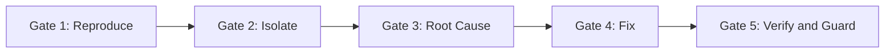

# Master Debugging & Troubleshooting Framework

A unified, comprehensive framework synthesizing all engineering debugging methodologies: systematic root-cause analysis, interactive runtime inspection, phase-gated triage, distributed tracing, memory forensics, frontend UI diagnostics, CI/CD pipeline recovery, and test pollution bisection.

---

## 1. The Iron Law & Core Principles

> [!IMPORTANT]
> **The Iron Law of Debugging:**
> **ALWAYS identify and prove the root cause before attempting fixes. Symptom fixes are failure.**
> Random edits, guessing, and quick patches mask underlying issues and compound technical debt.

### Non-Negotiable Rules
1. **Stop the Line:** When a bug or test failure occurs, halt new feature work immediately. Fix the failure at its source.
2. **Reproduce Deterministically:** If you cannot reproduce the bug with a single command or automated script, you do not understand the problem yet.
3. **Trace Backward to Origin:** Errors manifest late in the call stack. Never patch the point of explosion; trace backward to where the invalid state or corrupt data was first created.
4. **Isolate One Variable at a Time:** Never make multiple changes simultaneously. Form a hypothesis, change one variable, test, and record the result.
5. **Defense-in-Depth:** When fixing data corruption or boundary bugs, add validation at *every* layer (entry, domain, persistence, UI) to make recurrence structurally impossible.

---

## 2. The 5-Phase Gated Protocol

Never skip phases. Each gate has mandatory exit criteria before moving to the next.



### Phase 1: REPRODUCE (Gate 1)
* **Goal:** Create a minimal, reliable, isolated command or test case that triggers the bug 100% of the time.
* **Triage Checklist:**
  - [ ] Run the specific failing test in total isolation: `npm test -- -t "exact test name"` or `pytest path/to/test.py::test_func -vv`.
  - [ ] Check environment parity (OS, Node/Python/Go version, environment variables, dependencies).
  - [ ] Eliminate concurrency/flakiness noise: run with single thread/worker (`--workers=1`, `--runInBand`).
  - [ ] If non-deterministic, log timing, thread IDs, random seeds, and async event order.
* **Exit Criterion:** A single reproducible command/script that reliably triggers the failure.

### Phase 2: ISOLATE & LOCALIZE (Gate 2)
* **Goal:** Narrow down the exact file, commit, component, and state transition where failure occurs.
* **Bisection & Localization Tools:**
  * **Git Bisect (Commit Localization):**
    ```bash
    git bisect start
    git bisect bad HEAD
    git bisect good <last_known_good_commit_or_tag>
    git bisect run <test_command_or_script>
    # Git automatically finds the exact introducing commit
    git bisect reset
    ```
  * **Call Stack Deconstruction:**
    - Examine the innermost non-library stack frame.
    - Identify function inputs, return values, and mutated closures.
* **Exit Criterion:** Exact commit, file, function, and offending line(s) identified.

### Phase 3: ROOT CAUSE INVESTIGATION (Gate 3)
* **Goal:** Understand *why* the failure happened, tracing state back to its inception.
* **Methodology:**
  * **5 Whys & Backward Tracing:**
    - Step 0 (Symptom): `TypeError: Cannot read property 'id' of undefined` at line 142.
    - Why 1: Function received `user = undefined`.
    - Why 2: Repository query returned `null` for deleted record.
    - Why 3: Controller failed to check if `findById()` returned null.
    - Why 4: Origin: API route handler assumed token claims always match an existing DB row without checking.
  * **Hypothesis Formulation & Testing:**
    - State hypothesis explicitly: *"X happens because variable Y is null when condition Z occurs."*
    - Design a test that proves or disproves the hypothesis without modifying application code.
* **Exit Criterion:** Proven, evidence-backed explanation of the flaw and its propagation path.

### Phase 4: FIX IMPLEMENTATION (Gate 4)
* **Goal:** Apply the minimal, atomic, root-cause repair.
* **Requirements:**
  - Fix at the original corrupt state source, NOT downstream where symptoms appear.
  - Implement defense-in-depth:
    - Layer 1 (Boundary/Entry): Validate and sanitize inputs.
    - Layer 2 (Domain Model): Invariants enforced in entity/service constructors.
    - Layer 3 (Persistence/DB): Non-null constraints, foreign keys, or database checks.
  - Keep changes strictly atomic (no unrelated refactoring in the fix diff).
* **Exit Criterion:** Code compiles, passes the minimal reproduction script, and has zero unintended side-effects.

### Phase 5: VERIFY & GUARD (Gate 5)
* **Goal:** Prove the fix works and lock in regression protection.
* **Checklist:**
  - [ ] Minimal reproduction test passes.
  - [ ] Full existing test suite passes without regressions.
  - [ ] Add permanent regression unit/integration test covering edge cases (`null`, `empty`, boundary values).
  - [ ] Verify test cleanup and teardown (no pollution of filesystem, DB, or global state).
* **Exit Criterion:** Green test suite and permanent regression test committed.

---

## 3. Interactive Runtime Debugger Mechanics

When print/log statements are insufficient or too slow, use an interactive debugger (`pdb`, `node --inspect`, `gdb`, `lldb`).

### Breakpoint Strategy
| Breakpoint Type | Purpose | Syntax / Example |
| :--- | :--- | :--- |
| **Line Breakpoint** | Pause at target line | `breakpoint()` (Python), `debugger;` (JS/TS) |
| **Conditional Breakpoint** | Pause only when state corrupts | `breakpoint if userId is None` / `count > 100` |
| **Invariant Breakpoint** | Break when business invariant breaks | `balance < 0` or `len(items) == 0` |
| **Exception Breakpoint** | Pause immediately when error is thrown | `break on uncaught exceptions` |

### Execution Control Navigation
* **Step Over (`next` / `n`):** Executes current line without descending into function calls. Use when you know the called function is not the culprit.
* **Step Into (`step` / `s`):** Descends into the function call at the current line. Use when investigating internal behavior of that function.
* **Step Out (`finish` / `return` / `c`):** Completes the current function and pauses at the caller frame. Use to escape deep loops or utility libraries.
* **Frame Switching (`up` / `down`):** Navigate up and down the call stack frames to inspect caller state and arguments without altering execution pointer.

---

## 4. Specialized Debugging Domains

### A. Distributed Systems & Microservices
* **Correlation IDs:** Ensure every incoming request attaches an `X-Correlation-ID` or W3C `traceparent`. Verify propagation across HTTP clients, RPCs, and message brokers.
* **Distributed Traces (OpenTelemetry):**
  - Check spans for unexpected latency gaps (indicates uninstrumented calls or thread starvation).
  - Inspect span status: look for errored spans within successful parent spans.
* **Async Queues & Event-Driven Flows:**
  - Inspect Dead-Letter Queues (DLQ) for poison pills.
  - Check message idempotency keys: verify duplicate deliveries do not corrupt state.

### B. Frontend & UI Debugging
* **Reactive State vs DOM State:**
  - Verify if state updated in React/Vue/Svelte store vs whether DOM re-rendered.
  - Check for stale closures or missing dependency arrays in hooks (`useEffect`, `useCallback`).
* **Layout & CSS Rendering:**
  - Stacking Contexts: check `z-index`, `opacity < 1`, `transform`, `filter`.
  - Overflow Clipping: inspect container with `overflow: hidden` or fixed width/height constraints.
* **Network & Hydration:**
  - Look for SSR hydration mismatches (server HTML differs from client-rendered HTML).
  - Check browser console for CORS blocks, CSP violations, or unhandled promise rejections.

### C. Memory Leaks & Resource Starvation
* **Heap Snapshot Bisection:**
  1. Take Baseline Snapshot 1.
  2. Perform suspect action 10 times.
  3. Run garbage collection.
  4. Take Snapshot 2.
  5. Diff Snapshot 2 vs Snapshot 1: sort by **Retained Size**.
* **Common Root Causes:**
  - Unsubscribed event listeners, WebSockets, or RxJS observables.
  - Detached DOM nodes referenced by closures.
  - Unbounded cache / dictionary without eviction (missing LRU/TTL).
  - Unclosed database connections, file descriptors, or subprocess handles.

### D. CI/CD & Pipeline Failures
* **Pipeline Triage:**
  - Path Separators: Windows (`\`) vs Linux (`/`). Always use cross-platform path APIs.
  - Case Sensitivity: Linux filesystems are case-sensitive; Windows/macOS often are not.
  - Masked Secrets: If an API token is empty in CI, it may be unset or missing in runner secrets.
  - Cache Poisoning: Clear runner cache or run workflow with cache disabled.

### E. Test Pollution & Flaky Tests
* **Condition-Based Waiting (Eliminate Arbitrary Sleep):**
  ```typescript
  // BAD: Flaky arbitrary sleep
  await new Promise(resolve => setTimeout(resolve, 5000));

  // GOOD: Deterministic condition-based poll
  await waitFor(async () => {
    const status = await getJobStatus(jobId);
    return status === 'COMPLETED';
  }, { timeoutMs: 10000, intervalMs: 100 });
  ```
* **Test Pollution Bisection (`find-polluter` algorithm):**
  If test B fails only when run after test A, test A polluted shared state (DB, file system, singleton, global env).
  - Run tests in isolation vs in suite to verify order dependence.
  - Ensure every test cleans up its own fixtures in `afterEach` / `teardown`.

---

## 5. Error Classification Matrix

| Error Type | Category | Action Plan |
| :--- | :--- | :--- |
| **Transient Network / 503** | Transient / Boundary | Add exponential backoff with jitter and circuit breaker. |
| **400 Bad Request / Schema** | Permanent / Boundary | Validate input with strict schema (Zod/Pydantic) before processing. |
| **Null Pointer / Undefined** | Permanent / Internal | Trace source of missing state; add non-nullable types and invariant guards. |
| **Deadlock / Timeout** | Transient / Concurrency | Enforce strict lock ordering; add lock timeout; eliminate nested transactions. |
| **Out of Memory (OOM)** | Fatal / Resource | Profile heap allocations; stream large datasets instead of loading into memory. |

---

## 6. Cognitive Traps & Red Flags to STOP Immediately

If you catch yourself thinking any of the following, **STOP and return to Phase 1**:
* ❌ *"Let me just try this real quick and see if it works."* (Guessing violates the Iron Law).
* ❌ *"It works on my machine, so it's an infrastructure issue."* (Environment difference is a reproduction bug).
* ❌ *"Let's increase the timeout from 5s to 15s."* (Masks race conditions; use condition-based waiting).
* ❌ *"Let's wrap it in a try/catch and return null/empty."* (Swallowing exceptions conceals root causes).
* ❌ *"I don't know why this line fixed it, but the test passes now."* (Unverified fixes introduce regression landmines).

---

## 7. Quick Emergency Triage Cheat-Sheet

```bash
# 1. Isolate test execution
pytest tests/test_module.py::test_case -vv --capture=no --pdb
npm test -- path/to/test.spec.ts --inspect-brk -t "test_name"

# 2. Check recent changes
git log -p -n 5 -- <path/to/affected/file>

# 3. Locate commit regression
git bisect start HEAD <good_commit> && git bisect run <test_cmd>

# 4. Search for error signatures
grep -rn "<ErrorString>" src/
```
