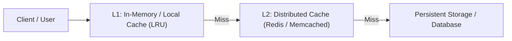

# Master Performance Engineering & Optimization Framework

A comprehensive, unified discipline synthesizing runtime profiling, latency reduction, throughput scaling, memory leak containment, caching hierarchies, and database tuning.

---

## 1. Core Principles of Performance Engineering

> [!IMPORTANT]
> **The First Law of Optimization:**
> **Never optimize without measurement.** Speculative optimization complicates code and rarely speeds up the actual bottleneck. Measure first, locate the true hotspot, optimize minimally, and verify with identical benchmarks.

### Guiding Laws
1. **Amdahl's Law:** The overall performance improvement gained by optimizing a single component is strictly limited by the fraction of time that component spends in the critical path:
   $$S_{\text{latency}} = \frac{1}{(1 - p) + \frac{p}{s}}$$
   *Never spend time optimizing code that represents only 2% of total execution time.*
2. **Percentiles Over Averages:** Mean latency masks catastrophic tail latency. Always measure and optimize $p_{50}$, $p_{90}$, $p_{95}$, $p_{99}$, and $p_{99.9}$.
3. **USE Method (Utilization, Saturation, Errors):** For every hardware and software resource (CPU, Memory, Disk, Network, Connection Pools), check:
   - **Utilization:** What percentage of time is the resource busy?
   - **Saturation:** How much work is queued waiting for this resource?
   - **Errors:** Are there dropped packets, rejected requests, or OOM events?

---

## 2. Profiling & Measurement Tools

### CPU Profiling & Flame Graphs
* **Sampling vs Instrumentation:** Prefer sampling profilers in production to minimize overhead ($\le 1-2\%$).
* **Reading Flame Graphs:**
  - **X-axis:** Alphabetical order of stack traces (width represents total CPU time spent).
  - **Y-axis:** Call stack depth.
  - **Triage Target:** Look for wide "plateaus" at the top of the flame graph—functions consuming significant CPU without calling downstream functions.

### Memory & Garbage Collection (GC) Profiling
* **Heap Snapshot Diffing:**
  1. Capture Snapshot A at idle.
  2. Execute suspect high-throughput workload.
  3. Force GC cycle.
  4. Capture Snapshot B and compare against A.
  5. Sort by **Retained Size** (memory freed if that object is collected) rather than Shallow Size.
* **GC Pressure:** High allocation rates cause frequent minor GC pauses and stop-the-world major GC spikes.
  - *Fix:* Object pooling, reusing buffers, avoiding unnecessary closures and intermediate arrays.

---

## 3. Latency Optimization & Caching Hierarchy

Design multi-tiered caching with explicit eviction rules:



### Caching Rules
* **Cache Stampede Prevention:** Use probabilistic early expiration (XFetch) or mutex locking on cache misses so 1,000 concurrent requests don't hammer the database simultaneously on key expiration.
* **Explicit TTL & Invalidation:** Every cached key MUST have a Time-To-Live (TTL). Event-driven invalidation (CDC or message bus) beats polling.
* **Negative Caching:** Cache "not found" / 404 responses with short TTL (e.g. 30 seconds) to prevent repeated expensive lookups for missing records.

---

## 4. Database & I/O Performance Tuning

### Eliminating N+1 Query Antipatterns
* **The Problem:** Fetching a parent record and looping over children, issuing 1 SQL query per child ($N+1$ roundtrips).
* **The Solution:** Eager loading, `JOIN` queries, or batch `IN (...)` fetching.

### Index Optimization Strategy
* **Index Selectivity:** Place the most selective column (highest cardinality) first in composite indexes.
* **Covering Indexes:** Include queried columns in index `INCLUDE` clauses so queries resolve entirely in the index tree without accessing table heap pages (`Index Only Scan`).
* **Avoid Function Transformations in WHERE:**
  - ❌ `WHERE DATE(created_at) = '2026-01-01'` (invalidates normal index).
  - ✅ `WHERE created_at >= '2026-01-01 00:00:00' AND created_at < '2026-01-02 00:00:00'`.

### Connection Pool Sizing Formula
Most connection pools are vastly oversized, causing context-switching overhead on the database server.
$$\text{Max Connections} = 2 \times \text{CPU Cores} + \text{Effective Spindles / Disks}$$

---

## 5. Concurrency, Asynchrony & Batching

* **Batching & Coalescing:** Group micro-operations into batch writes (e.g., buffering logs or inserts for 50ms or until 500 items accumulate).
* **Non-Blocking I/O:** Never perform synchronous file I/O or blocking network calls inside high-frequency event loops or request threads.
* **Work Stealing & Thread Pools:** Size worker thread pools according to workload type:
  - **CPU-bound:** $N_{\text{threads}} = \text{CPU Cores}$.
  - **I/O-bound:** $N_{\text{threads}} = \text{CPU Cores} \times \left(1 + \frac{\text{Wait Time}}{\text{Compute Time}}\right)$.

---

## 6. Frontend & Core Web Vitals (CWV)

| Metric | Target | Focus Area | Optimization Levers |
| :--- | :--- | :--- | :--- |
| **LCP** (Largest Contentful Paint) | $\le 2.5\text{s}$ | Loading | Preload hero images, SSR, critical CSS inlining, CDN edge delivery. |
| **INP** (Interaction to Next Paint) | $\le 200\text{ms}$ | Responsiveness | Yield main thread (`requestIdleCallback`, `scheduler.yield`), break long tasks ($>50\text{ms}$). |
| **CLS** (Cumulative Layout Shift) | $\le 0.1$ | Visual Stability | Set explicit `width`/`height` on images and iframes; reserve layout space for ads/dynamic slots. |

---

## 7. The Performance Verification Workflow

```bash
# 1. Capture baseline benchmark
autocannon -c 100 -d 30s http://localhost:8080/api/endpoint > baseline.txt

# 2. Run profiler under load
node --prof app.js &
autocannon -c 100 -d 30s http://localhost:8080/api/endpoint
node --prof-process isolate-*.log > cpu-profile.txt

# 3. Apply targeted optimization
# 4. Run verification benchmark under identical parameters
autocannon -c 100 -d 30s http://localhost:8080/api/endpoint > post-opt.txt

# 5. Calculate percentage improvement across p50, p99, and RPS
```
