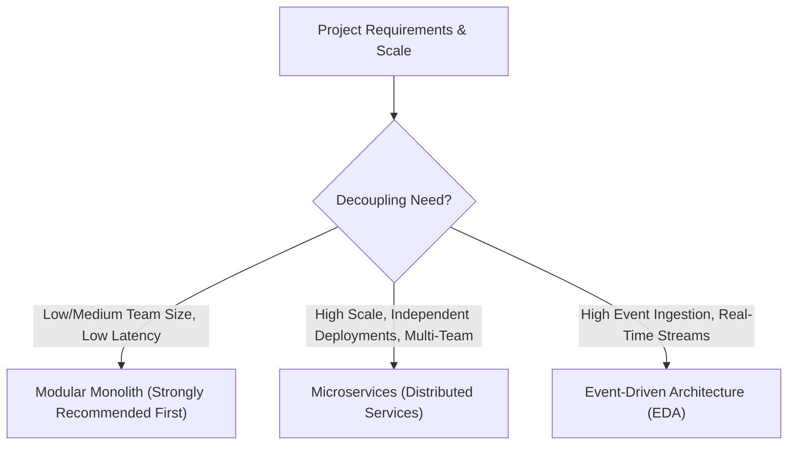
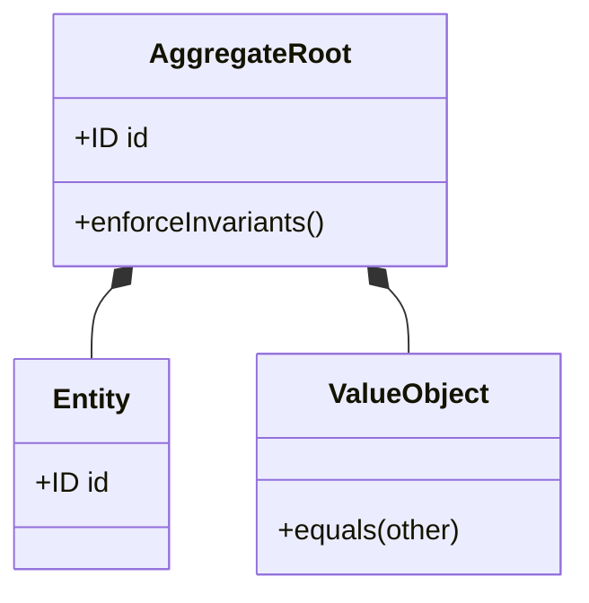

# Master Software Architecture & System Design Framework

A comprehensive, unified discipline synthesizing modern software architecture: strategic and tactical Domain-Driven Design (DDD), boundary definition, architectural patterns (Clean/Hexagonal, CQRS, Event Sourcing, Saga), API communication protocols, and architectural governance.

---

## 1. Architectural Paradigms & Topology Selection



### Modular Monolith vs Microservices Decision Rubric
* **Start with a Modular Monolith:** Premature distribution into microservices introduces distributed complexity (network latency, partial failures, distributed transactions, observability overhead) before domain boundaries stabilize.
* **Microservices Justification Threshold:**
  - Independent scaling requirements for vastly different workloads (e.g. video processing vs authentication).
  - Autonomous engineering teams needing independent release cycles without coordinated deployments.
  - Strict compliance or security isolation boundaries.

---

## 2. Domain-Driven Design (DDD)

### Strategic Design (Macro Boundaries)
* **Ubiquitous Language:** Common, rigorous vocabulary shared between domain experts and software engineers, reflected directly in code identifiers.
* **Bounded Contexts:** Explicit boundaries within which a particular domain model applies. Different contexts can model the same real-world entity differently (e.g. `User` in Auth Context vs `Customer` in Billing Context vs `Recipient` in Shipping Context).
* **Context Mapping Relationships:**
  - **Shared Kernel:** Shared subset of domain model between teams (requires mutual coordination).
  - **Customer / Supplier:** Downstream depends on upstream; upstream plans deliverables to satisfy downstream.
  - **Anti-Corruption Layer (ACL):** Downstream service translates external/upstream models into its own clean domain abstractions, isolating itself from foreign API changes.

### Tactical Design (Code Level)


* **Entities:** Objects defined by unique identity that persists across state changes (e.g., `Order`, `Account`).
* **Value Objects:** Immutable objects defined purely by their attributes; have no conceptual identity (e.g., `Money(10.00, USD)`, `Address`, `DateRange`). Two value objects with identical attributes are equal.
* **Aggregates & Aggregate Roots:** A cluster of associated entities and value objects treated as a single transactional consistency unit. External objects may only reference the Aggregate Root.
* **Repositories:** Interface providing collection-like access to retrieve and persist entire Aggregates by ID.
* **Domain Events:** Record of significant occurrences in the domain, named in the past tense (e.g., `OrderPlaced`, `PaymentFailed`).

---

## 3. Structural Patterns & Styles

### A. Hexagonal / Clean / Ports & Adapters Architecture
The core business domain must have **zero dependencies** on frameworks, UI, or databases:
* **Domain Layer (Center):** Pure business logic, Entities, Value Objects, Domain Services. No imports from external libraries or databases.
* **Ports (Interfaces):** Application contracts (Input Ports for use-cases; Output Ports for repositories, notification services).
* **Adapters (Infrastructure):** Concrete implementations (HTTP controllers, SQL repositories, Kafka consumers, AWS S3 clients).

### B. Command Query Responsibility Segregation (CQRS)
* **Command Side (Write):** Optimized for data integrity, strict business invariants, and transactional safety. Returns success/failure or event IDs, not full entity graphs.
* **Query Side (Read):** Optimized for low-latency queries, UI presentation, and complex aggregations. Bypasses domain validation; queries denormalized read-model tables or Elasticsearch views.

### C. Event Sourcing
* State is never updated in-place via SQL `UPDATE`. Instead, state is represented as an append-only stream of immutable events (`AccountOpened`, `MoneyDeposited`, `MoneyWithdrawn`).
* Current state is reconstituted by replaying past events.
* Provides flawless audit trails, time-travel debugging, and easy generation of new read projections.

### D. Distributed Transactions & Saga Pattern
When a business process spans multiple services, avoid two-phase commit (2PC). Use Sagas:
* **Choreography:** Services publish and listen to domain events; each service executes local transaction and publishes next event.
* **Orchestration:** A central Saga Orchestrator manages the workflow, dispatches commands to services, and triggers compensating transactions on failure (e.g., `CancelReservation` if `ProcessPayment` fails).

---

## 4. API Communication Protocols

| Protocol | Best For | Tradeoffs |
| :--- | :--- | :--- |
| **REST (HTTP/JSON)** | Public APIs, standard CRUD web services | Simple, universal, but prone to over/under-fetching. |
| **gRPC (HTTP/2 + Protobuf)** | High-throughput internal microservice-to-microservice RPC | Binary efficiency, typed contracts, but requires HTTP/2 and binary tooling. |
| **GraphQL** | Rich web/mobile client dashboards | Single roundtrip for nested relations, but complex caching and query complexity attacks. |
| **Message Brokers (Kafka/RabbitMQ)** | Asynchronous decoupled event delivery | High throughput, resilience, but eventual consistency and complex operational overhead. |

---

## 5. Architectural Decision Records (ADR) Template

Document all significant architectural choices with an ADR:

```markdown
# ADR-001: Adoption of Event-Driven Saga for Order Fulfillment

## Status
Accepted

## Context
Order fulfillment requires coordination across Inventory, Payment, and Shipping services. Synchronous HTTP calls cause distributed locks and cascading timeouts during payment gateway degradation.

## Decision
We adopt an Orchestrated Saga using temporal state machines and Kafka event topics.

## Consequences
### Positive
- High resilience: temporary downtime in shipping does not fail payment.
- Automatic compensating transactions on payment failure.

### Negative / Tradeoffs
- Eventual consistency requires UI to handle pending states.
- Additional operational overhead of monitoring Saga execution states.
```
