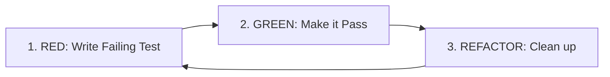

# Master Testing, TDD & QA Engineering Framework

A comprehensive, unified testing discipline synthesizing the entire verification lifecycle: test-driven development (TDD), unit, integration, API contract, and end-to-end (E2E) testing, test double taxonomy, flaky test eradication, and mutation testing.

---

## 1. The Testing Pyramid & Test Portfolio

A balanced test portfolio guarantees high confidence, fast feedback loops, and low maintenance overhead:

```
        /\          E2E / System (5-10%)
       /  \         - Full critical user journeys (Playwright/Cypress)
      /----\        - High cost, slower, highest fidelity
     /      \       Integration & API (20-30%)
    /        \      - Component boundaries, database queries, HTTP contracts
   /----------\     - Medium cost, medium speed
  /            \    Unit Tests (60-70%)
 /              \   - Pure domain logic, state transitions, algorithms
/----------------\  - Extremely fast (milliseconds), isolated, deterministic
```

### Key Rules
1. **Push Tests Down the Pyramid:** If a behavior can be verified reliably by a fast unit test, do not rely exclusively on a slow, flaky E2E test.
2. **Deterministic Execution:** Tests must never depend on the outcome of previous tests, clock time without freezing, or network connectivity (for unit suites).
3. **Guard Against False Greens:** A test that passes when the underlying feature is broken is worse than no test. Always watch tests fail before watching them pass.

---

## 2. Test-Driven Development (TDD) Lifecycle

The strict Red-Green-Refactor cycle guarantees minimal, tested, modular architecture:



### Phase 1: RED (Write the Minimal Failing Test)
* **Rule:** Do not write a single line of production code until you have a failing test.
* **Requirements:**
  - Define the desired API / function signature from the caller's perspective.
  - Run the test and verify that it **fails for the expected reason** (e.g. `AssertionError`, not a syntax error or missing module import).
  - This step proves the test is active and prevents "false green" tests.

### Phase 2: GREEN (Make the Test Pass)
* **Rule:** Write the simplest, most direct code that satisfies the test.
* **Requirements:**
  - Do not implement hypothetical future requirements (YAGNI).
  - Focus purely on making the test suite pass (green bar).
  - Quick implementations (even hardcoding temporarily) are acceptable in baby steps to verify the contract.

### Phase 3: REFACTOR (Improve Structure Under Green Bar)
* **Rule:** Clean up technical debt while keeping tests 100% green.
* **Requirements:**
  - Remove duplication (DRY).
  - Improve variable and function names.
  - Extract helper methods or split responsibilities.
  - Rerun tests after every minor edit to ensure no regressions.

---

## 3. Unit Testing & AAA Pattern (Arrange-Act-Assert)

Every unit test must follow the standard 3-stage structure:

```typescript
describe('OrderProcessingEngine', () => {
  it('applies 10% discount when promo code is valid', () => {
    // 1. Arrange: Setup fixtures, inputs, and preconditions
    const cart = new Cart({ items: [{ price: 100, qty: 1 }] });
    const promo = new PromoCode('SAVE10', 0.10);

    // 2. Act: Trigger the exact operation under test
    const finalPrice = cart.applyDiscount(promo);

    // 3. Assert: Verify the outcome and invariants
    expect(finalPrice).toBe(90.00);
    expect(cart.discountApplied).toBe(true);
  });
});
```

### Best Practices for Unit Tests
* **One Logical Assertion:** Assert on the final state or contract, not every incidental intermediate variable.
* **Isolated State:** Never share mutable instances across tests. Instantiate fresh fixtures inside `beforeEach()`.
* **Descriptive Naming:** Format: `it('should [expected behavior] when [condition]')`.

---

## 4. Test Doubles & Mocking Taxonomy

Choose the simplest test double that satisfies the test:

| Test Double | Purpose | Best Used For |
| :--- | :--- | :--- |
| **Dummy** | Passed to satisfy parameter list; never actually used | Required constructor parameters that don't affect test |
| **Stub** | Returns hardcoded answers to calls during the test | Third-party services, database queries, clock time |
| **Spy** | Wraps a real object and records how it was called | Verifying notifications sent, callbacks triggered |
| **Mock** | Pre-programmed with expectations of specific calls | Verifying critical side-effects (e.g., payment processed) |
| **Fake** | Working implementation with shortcuts (e.g., In-Memory DB) | High-fidelity integration testing without network |

### The Golden Rule of Mocking
> [!CAUTION]
> **Mock at Architectural Boundaries, Never Internal Domain Logic:**
> - ✅ DO mock: Third-party payment APIs, external message queues, file system, network requests.
> - ❌ DO NOT mock: Internal domain entities, utility functions, or simple collaborators. Over-mocking leads to brittle tests that break upon refactoring even when code works.

---

## 5. Integration & API Testing

* **Contract Validation:** Validate JSON request and response payloads against strict OpenAPI / JSON schemas.
* **Status Code Coverage:**
  - 200/201: Successful operations with correct body schema.
  - 400: Malformed input, missing required fields.
  - 401/403: Unauthenticated or unauthorized access.
  - 404: Non-existent resources.
  - 409: Conflict / idempotency violation.
* **Database Sandboxing:**
  - Execute integration tests inside rollback transactions or isolated ephemeral databases (e.g. Testcontainers or SQLite in-memory).

---

## 6. Resilient End-to-End (E2E) Testing

* **Resilient Element Selectors:**
  - ❌ Avoid fragile CSS/XPath: `div > div:nth-child(2) > span.btn-blue`
  - ✅ Use Accessible Roles or Data Attributes: `page.getByRole('button', { name: 'Submit' })` or `page.locator('[data-testid="order-submit"]')`
* **Condition-Based Waits (No Arbitrary Sleep):**
  - Never use `time.sleep()` or `setTimeout()` in test suites.
  - Always wait on deterministic DOM states, network idle events, or response promises.
* **Idempotent Fixture Teardown:**
  - Every E2E test run must clean up any created entities (users, orders, files) to prevent test database bloat.

---

## 7. Flaky Test Eradication & Test Pollution Bisection

### Eliminating Common Flakiness Causes
1. **Clock & Time Drift:** Always freeze time in tests using libraries like `Sinon`, `freezegun`, or Jest's fake timers.
2. **Order Dependence (Pollution):** A test fails only when run after another test that mutated global state, environment variables, or database records.
3. **Async Race Conditions:** Tests asserting on state before async promises resolve.

### Finding Test Polluters (Bisection Algorithm)
If Test `B` passes in isolation but fails when run in the full suite:
1. Run Test `B` alone: `npm test -- B.test.ts` (Confirms it passes in isolation).
2. Binary search the test suite: Run first half + Test `B`.
3. If failure reproduces, polluter is in first half; if not, in second half.
4. Repeat until the single test creating the corrupt state is identified.
5. Fix by resetting shared state in `afterEach()`.

---

## 8. Mutation Testing & Quality Gates

* **Mutation Testing (Stryker / mutmut):**
  - Modifies your production code (e.g., changes `>` to `<`, `true` to `false`, deletes return statements).
  - If your test suite still passes after code mutation, your tests are weak ("false green").
  - **Mutation Score:** Target $\ge 80\%$ mutation kill rate on critical business logic.
* **Coverage Standards:**
  - High line coverage without edge cases is meaningless. Focus on branch coverage and boundary condition assertions.
