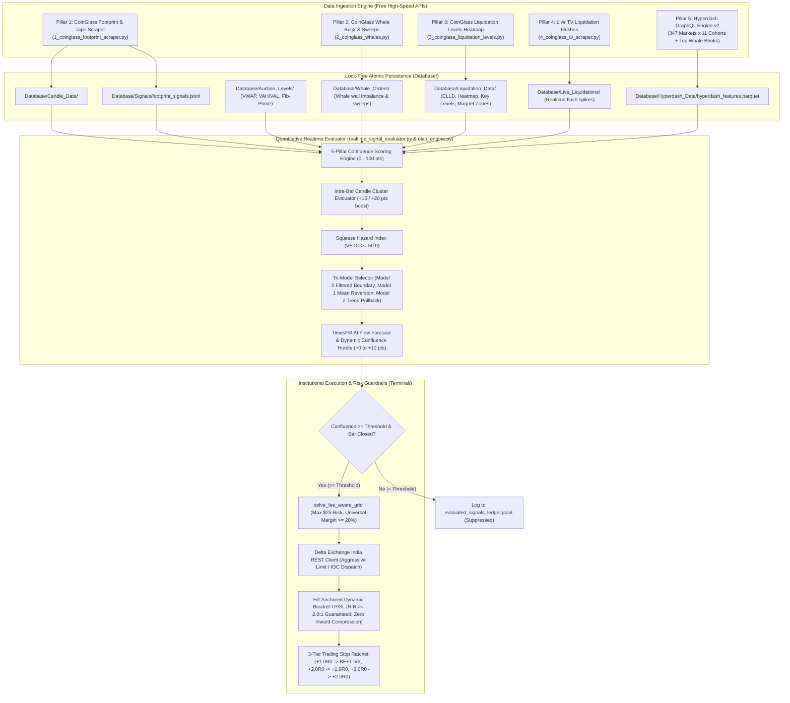

# Trade Formulation & Quantitative Data Processing Pipeline

**System Target:** Delta Exchange India Futures (Automated Execution & Demo Shadowing)  
**Execution Venue:** Delta Exchange India API (`https://cdn-ind.testnet.deltaex.org` / `https://api.india.delta.exchange`)  
**Data Standards:** 15m Completed Bars (`t_ms % 900_000 == 0`), Primary Indian Standard Time (IST, UTC+5:30)  
**Core Invariant:** Minimum 1:2 Risk-Reward ($R:R \ge 2.0$) fill-anchored, fee-aware $25 max risk  

---

## 1. Executive Pipeline Architecture

The quantitative trading pipeline operates as a **closed-loop reactive intelligence architecture**. Raw market tape, order books, liquidation feeds, and institutional wallet cohorts are continuously ingested, normalized, cross-evaluated across 5 quantitative pillars, and dispatched with institutional risk controls.

---

## 2. Deep Dive: How Hyperdash Institutional Intelligence is Fetched & Used

Hyperdash intelligence provides an unfiltered look into the order flow and open positions of top crypto perpetual traders, segregated into **PnL cohorts** (Apex, Extremely Profitable, Profitable, Rekt) and **Capital cohorts** (Whales, Sharks, Shrimps).

### 2.1 The Data Fetching Mechanism
- **Engine File:** [`Terminal/hyperdash_intel_engine.py`](file:///c:/Users/SIGMA/Documents/_Trading_1/Terminal/hyperdash_intel_engine.py)
- **Transport:** Direct, zero-docker, unauthenticated HTTPS POST to `https://api.hyperdash.com/graphql`.
- **Query 1 (`GetPerpsMarketParticipation`):**
  - Sweeps **347 perpetual markets** across **11 trader cohorts**.
  - Returns `longTraderCount`, `shortTraderCount`, `profitableTraderCount`, `losingTraderCount`, `totalLongNotional`, and `totalShortNotional`.
- **Query 2 (`GetTickerPositions`):**
  - Requests the top 10 whale positions for the specific asset being evaluated.
  - Ingests `displayName`, `address`, signed `size`, `entryPrice`, `liquidationPrice`, and `unrealizedPnl`.
- **Persistence & Caching:**
  - In-memory cache with 60-second TTL (positive whale cache 90s, negative-cache retry 15s).
  - Persisted atomically to [`Database/Hyperdash_Data/hyperdash_features.parquet`](file:///c:/Users/SIGMA/Documents/_Trading_1/Database/Hyperdash_Data/hyperdash_features.parquet). On cold startup, features are loaded from disk with **0.0ms latency**.

### 2.2 Mathematical Formulas for Hyperdash Features

#### A. Smart Money Bias (Capital-Conviction Weighted)
Smart traders have capital at risk. Conviction is measured in **dollars**, using incremental disjoint cohort weights:
$$\text{SmartBias}_{\text{coin}} = \frac{\sum_{c} w_{c}^{\text{smart}} \cdot \text{NetBiasUSD}_{c}}{\sum_{c} w_{c}^{\text{smart}}}$$
Where:
- $\text{NetBiasUSD} = 100 \times \frac{\text{LongUSD} - \text{ShortUSD}}{\text{LongUSD} + \text{ShortUSD}}$
- Cohort weights: `Apex = 3.0`, `Extremely Profitable = 1.0`, `Whale = 1.2`, `Shark = 0.4`, `Very Profitable = 0.3`, `Profitable = 0.1`.

#### B. Crowd Bias (Retail Herding Headcount)
Retail herding is measured by **bodies (trader count)**, not dollars:
$$\text{CrowdBias}_{\text{coin}} = \frac{\sum_{c} w_{c}^{\text{crowd}} \cdot \text{NetBiasCount}_{c}}{\sum_{c} w_{c}^{\text{crowd}}}$$
Where:
- $\text{NetBiasCount} = 100 \times \frac{N_{\text{long}} - N_{\text{short}}}{N_{\text{long}} + N_{\text{short}}}$
- Cohort weights: `Rekt = 2.5` (contrarian pain fuel), `Very Unprofitable = 1.5`, `Unprofitable = 0.7`, `Fish/Shrimp = 0.3-0.5`.

#### C. Whale Liquidation Sweep Targets
Each whale's `liquidationPrice` is extracted and clustered:
- **Short Whales Liquidate ABOVE Price**: Acts as overhead squeeze magnets (fuel for BUY orders).
- **Long Whales Liquidate BELOW Price**: Acts as downside cascade fuel (fuel for SELL orders).
$$\text{SweepScore} = \text{NotionalUSD} \cdot \exp\left(-\frac{|\text{dist\_pct}|}{3.0}\right)$$

### 2.3 How Hyperdash Modifies Confluence & Formulates the Trade
1. **Smart Money Accumulation / Distribution:**
   - **BUY Signal:** If `SmartBias >= +15.0%` $\implies$ **+10 pts boost**. If `SmartBias <= -20.0%` (smart money heavily shorting) $\implies$ **-15 pts penalty**.
   - **SELL Signal:** If `SmartBias <= -15.0%` $\implies$ **+10 pts boost**. If `SmartBias >= +20.0%` (smart money heavily buying) $\implies$ **-15 pts penalty**.
2. **Retail Squeeze Fuel:**
   - **BUY Signal:** If `SmartBias >= +10.0%` and `CrowdBias <= -20.0%` (retail trapped short) $\implies$ **+10 pts boost** (`CROWD_SQUEEZE_LONG`).
   - **SELL Signal:** If `SmartBias <= -10.0%` and `CrowdBias >= +20.0%` (retail trapped long) $\implies$ **+10 pts boost** (`CROWD_SQUEEZE_SHORT`).
3. **Whale Sweep Target Magnet Boost:**
   - Short whale liquidation cluster sitting 0.3% to 5.0% above price $\implies$ **+8 pts boost** (identifies target take-profit level).
   - Long whale liquidation cluster sitting within 1.2% below entry $\implies$ **-8 pts penalty** (stop-out danger zone).
4. **Staleness Guard:**
   - If Hyperdash snapshot age exceeds 900s (15 min), `data_valid = False` and the score is neutralized (0 boost, 0 penalty) to avoid acting on stale intel.

---

## 3. The 5 Quantitative Pillars: How Every Data Point Formulates a Trade

When a footprint candle closes, all 5 pillars are simultaneously queried via the zero-latency OLAP layer ([`Terminal/olap_engine.py`](file:///c:/Users/SIGMA/Documents/_Trading_1/Terminal/olap_engine.py)) to construct the quantitative confluence score (0 to 100).

| Pillar | Data Source | Key Metric Ingested | Quantitative Confluence Contribution |
| :--- | :--- | :--- | :--- |
| **Pillar 1: Footprint & Cluster Signals** | `1_coinglass_footprint_scraper.py` | Order flow delta, absorption, trapped shorts/longs, delta divergence. | **Base Confluence: +20 to +40 pts**. Dual Unanimous Cluster: **+15 pts**. Triple Unanimous Cluster: **+20 pts**. Opposing Discordant Conflict: **-20 pts & VETO**. |
| **Pillar 2: Auction Profile & Value Areas** | `Database/Auction_Levels/*.parquet` | Day VWAP, Day VAH, Day VAL, Day POC, Fib-Prime EMAs [55, 89, 233]. | **Model 0 (Filtered Boundary): +10 to +25 pts** (VWAP/Fib ribbon confirmation, HTF directional congruence, boundary defense). **Model 1 (Mean Reversion): +15 to +25 pts** (fading VAH/VAL back to VWAP). **Model 2 (Trend Pullback): +15 to +40 pts** (EMA 55-89 pocket bounce with HTF alignment). |
| **Pillar 3: Live TV Liquidations & Reversals** | `4_coinglass_tv_scraper.py` & `Database/Live_Liquidations/` | 15m real-time liquidation spike (USD volume & exhaustion score). | **Capitulation Reversal: +15 to +20 pts** (e.g. $100k+ long flush bottom). **Adverse Blow-off Trap: -15 pts** (buying top of short squeeze). |
| **Pillar 4: Liquidation Heatmap & Strike Magnets** | `3_coinglass_liquidation_levels.py` & `Database/Liquidation_Data/` | Cumulative Liquidation Levels (CLLD), near-field shorts %, overhead/underlying strike magnets, key liquidation barriers. | **Whale Liquidation Targets: +8 pts**. **Near-Field Density Dominance: +5 pts** (0-1% or 1-2% band net delta). **Cascade Fuel: +5 to +10 pts** (near-field imbalance > 52%). **CLLD Turn: +5 pts** (bullish/bearish shift confluence). **Strike Target Magnet: +10 pts** (overhead short liqs for BUY, underlying long liqs for SELL). **Key Strike Barriers: +5 pts** (nearest short/long strike barrier). |
| **Pillar 5: Whales & Hyperdash Intel** | `2_coinglass_whales.py` & `Terminal/hyperdash_intel_engine.py` | Order book whale bid/ask imbalance, aggressive swept volume, Hyperdash Smart Money & Crowd Bias. | **Whale Book Imbalance: +15 pts** (>= 55% bids for BUY, <= 45% for SELL). **Whale Sweeps: +5 pts**. **Hyperdash Smart Money: +10 pts** (penalty -15 pts if opposing). **Hyperdash Squeeze Fuel: +10 pts**. **Whale Sweep Magnet: +8 pts** (penalty -8 pts if within stop-out danger zone). |

---

### 3.1 The Three Execution Models (Model 0, Model 1, Model 2)

Trade setup formulation evaluates market structure to select one of three dedicated execution models:

1. **Model 2: Dynamic Fib-Prime Trend Pullback (Highest Priority)**
   - **Trigger Condition:** Fired when candidate direction aligns with macro Higher Timeframe trend (1H & 4H both Bullish for BUY, or both Bearish for SELL).
   - **Geometry:** Enters pullbacks toward the dynamic Fib-Prime ribbon pocket [EMA 55, 59] (+15 pts) and directional close defending EMA 59 (+10 pts).
   - **Stop-Loss Anchor:** Stop loss is anchored behind the structural base **EMA 89**.
   - **Take-Profit Target:** Anchored to nearest liquidation magnet zone $\ge 2.0R$ away, or projected at $+2.0R_0$ / $+3.0R_0$.

2. **Model 1: Value Area Mean Reversion (Second Priority)**
   - **Trigger Condition:** Fired when macro trend is neutral/divergent and market is in consolidation (`MEAN_REVERTING_RANGE`, `CHOP`, or `HIGH_VOLATILITY_COMPRESSION`), with price testing Value Area boundaries (VAL/VAH or VWAP $\pm 1\sigma$).
   - **Geometry:** Fades oversold/overbought discount back toward Day VWAP (+15 to +25 pts).
   - **Stop-Loss Anchor:** Stop loss is anchored behind the extreme Value Area boundary (VAL for long, VAH for short).
   - **Take-Profit Target:** Day VWAP (extended to opposite boundary if VWAP distance $< 2.0R$).

3. **Model 0: Filtered Boundary (Default Fallback)**
   - **Trigger Condition:** Active when neither macro trend (Model 2) nor clear range boundary fade (Model 1) triggers.
   - **Geometry:** Validates setups with Price vs Day VWAP confirmation (+10 pts), Fib-Prime ribbon alignment (+10 pts), HTF directional congruence (+15 pts), or HTF divergence penalty (-10 pts).
   - **Stop-Loss Anchor:** Anchored to dynamic volatility envelope: $\text{SL Distance} = \text{clip}(1.5 \times \text{ATR}_{15m}, 0.5\%, 2.5\%)$.
   - **Take-Profit Target:** Calibrated to at least $2.0 \times \text{SL Distance}$ or nearest overhead/underlying strike magnet.

---

### 3.2 Dynamic TimesFM AI Flow Forecasting & Uncertainty Hurdle Adjustment

The pipeline integrates Google DeepMind's TimesFM zero-shot foundation model for time-series forecasting:
- **Input:** Volume-normalized Cumulative Volume Delta ratio series ($r_t = \frac{\Delta \text{CVD}_t}{\text{Volume}_t} \in [-1.0, 1.0]$) over a context of up to 128 completed bars.
- **Horizon & Quantiles:** Projects normalized order flow across a 24-step forecast horizon, outputting point predictions and quantile bands ($q_{10}, q_{50}, q_{90}$).
- **Adverse-Flow Veto:** If the 80% forecast interval directly opposes candidate trade direction across the entire horizon (e.g. all $q_{90} < 0.0$ for BUY, or all $q_{10} > 0.0$ for SELL), the signal is vetoed (`adverse_veto = True`).
- **Dynamic Confluence Hurdle Adjustment:** When predictive interval uncertainty widens ($\text{mean\_interval\_width} > 0.40$), an uncertainty penalty dynamically scales the required execution hurdle:
  $$\text{Hurdle} = \text{clip}((\text{mean\_interval\_width} - 0.40) \times 15.0, 0.0, 10.0)$$
  $$\text{Required Confluence Threshold} = 75.0 + \text{Hurdle}$$
  This raises the qualification bar from 75.0 up to 85.0 in volatile, low-predictability regimes.

---

### 3.3 Zero-Latency Query Engine (`Terminal/olap_engine.py`)

All real-time signal evaluations query microstructural indicators through [`Terminal/olap_engine.py`](file:///c:/Users/SIGMA/Documents/_Trading_1/Terminal/olap_engine.py).
- **DuckDB / Polars In-Memory Architecture:** Avoids blocking synchronous network requests during signal dispatch. Background scrapers keep parquet tables hot on disk, and the OLAP engine serves sub-millisecond point-in-time snapshots for auction profiles, CVD trends, whale walls, and liquidation matrices.

---

## 4. Execution Guardrails & Risk Formulation

Once a setup achieves a composite score $\ge 75.0/100$, it passes through the institutional execution gate.

### 4.1 Strict Risk Cap ($25 USD)
The position size $S$ (contracts) is solved mathematically via `solve_fee_aware_grid`:
$$\text{Max Risk USD} = (\text{SL Distance} \times S \times \text{Contract Value}) + \text{Taker Commission} \le \$25.00$$
If free available margin buffer is $< 20.0\%$, the order fails closed (`FAIL_CLOSED_MARGIN_REJECTED`).

### 4.2 Minimum 1:2 Risk-Reward ($R:R \ge 2.0$) Fill-Anchored Invariant
- Brackets are anchored not to theoretical signal price, but to the **actual filled execution price** ($P_{\text{fill}}$):
  $$R_0 = |P_{\text{fill}} - P_{\text{SL}}|$$
  $$P_{\text{TP1}} \ge P_{\text{fill}} \pm (2.0 \times R_0)$$
- **Dynamic Target Extension:** If the structural target (e.g., VWAP) offers less than 2.0R, target extension automatically extends TP1 to the opposite Value Area (VAH/VAL) or dynamic liquidity strike level to guarantee $R:R \ge 2.0$.

### 4.3 Monotonic 3-Tier Trailing Stop Ratchet
As the trade progresses in profit:
- **Tier 1 ($+1.0R_0$ profit):** SL moves to **Breakeven (+1 tick buffer)**. Capital risk eliminated ($R_{\text{open}} = 0$).
- **Tier 2 ($+2.0R_0$ profit):** SL moves to **lock $+1.0R_0$ guaranteed profit**, and TP is widened to $+3.0R_0$.
- **Tier 3 ($+3.0R_0$ profit):** SL moves to **lock $+2.0R_0$ guaranteed profit**.

---

## 5. Live Verification Status (Delta Exchange Demo Account)

1. **Demo Account Integration Verified:**
   - REST Host: `https://cdn-ind.testnet.deltaex.org`
   - User ID: `48328111`
   - Active Position Tested: **`BTCUSD` Long (1 contract, +0.001 BTC @ $80,178.00)** with attached bracket SL/TP.
   - Balances: `999.95 USD`, `0.25 BTC`, `10.0 ETH`.
2. **Data Scraping Freshness:**
   - All 5 background daemons are actively cycling 31 instruments every 15 minutes.
   - Parquet dumps in `Database/Candle_Data/`, `Database/Live_Liquidations/`, `Database/Whale_Orders/`, and `Database/Hyperdash_Data/` are completely up-to-date and lock-free.
3. **Automated Test Suite Status:**
   - **86 / 86 automated regression & unit tests passing green** in 25.39s.
