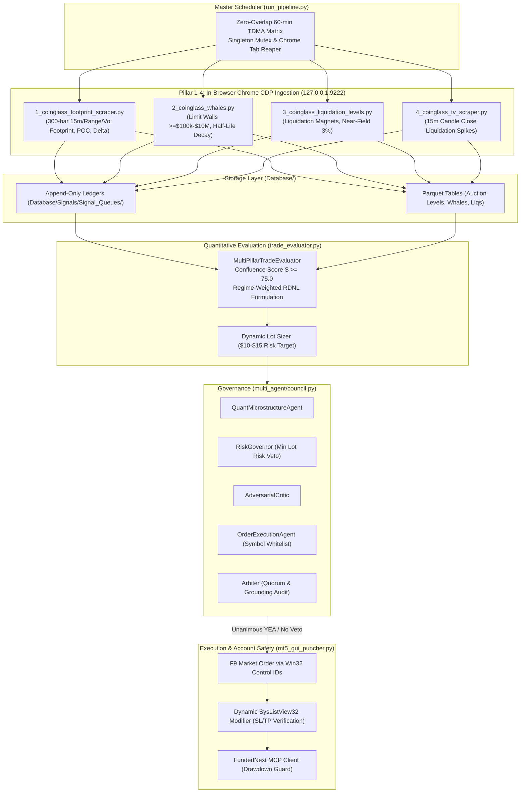

# 🏛️ MASTER INSTITUTIONAL SYSTEM AUDIT & ARCHITECTURAL REVIEW DIRECTIVE FOR Z.AI

> **Instructions for the User:**  
> Copy the complete markdown prompt below and paste it directly into your chat session with **Z.AI** (`chat.z.ai`).  
> It equips Z.AI with full codebase context, mathematical specifications, account constraints, and explicit institutional review questions across the entire 360-degree pipeline.

---

```markdown
# 🏛️ INSTITUTIONAL QUANTITATIVE AUDIT & MULTI-AGENT ARCHITECTURE DIRECTIVE

**To:** Lead Quantitative Systems Architect, HFT Microstructure Engineer & Distributed Multi-Agent Lead (Z.AI)  
**Target Repository:** `_Trading_1` (Production 5-Pillar Cryptocurrency Microstructure & Order Flow Trading Pipeline)  
**Execution Environment:** Windows 11 Pro | Python 3.14 (AsyncIO, DuckDB, Polars, Playwright/CDP) | MetaTrader 5 Build 5150 (`FundedNext-Server`) | Chrome DevTools Protocol (`127.0.0.1:9222`)  
**Live Target Account:** FundedNext Stellar Lite $5K Challenge P1 (Login: `11808165`)  
**Strict Capital Risk Bounds:**
  - Maximum Loss Breach Threshold: **`$4,600.00`** (Hard failure line)
  - Current Account Balance / Equity: **`$4,679.37`**
  - Remaining Risk Cushion: **`$79.37`**
  - Maximum Per-Trade Dollar Risk: **`$10.00` to `$15.00`** (Strictly bounded to $\le 25\%$ of remaining cushion = $\le \$19.84$)
  - Minimum Risk:Reward Ratio: **$\ge 2.0$**
  - Active Running Trades: **`0`** (Completely flat)

---

## 1. REPOSITORY TOPOLOGY & 360 PIPELINE ARCHITECTURE

Our quantitative trading system runs a continuous, zero-overlap, 15-minute candle-aligned pipeline that ingests real-time order flow and auction microstructure, persists atomic data, runs multi-pillar signal confluence scoring, deliberates via an adversarial Multi-Agent Council, and punches orders into MetaTrader 5 with automated server-side Stop Loss and Take Profit protection.



---

## 2. CODEBASE AUDIT FINDINGS ALREADY IMPLEMENTED

During our internal line-by-line engineering audit, we identified and remediated the following critical vulnerabilities:

1. **Trailing Stop Inversion & Short Direction Branching (`trade_evaluator.py`)**:
   - *Previous Flaw:* `TrailingStopManager` evaluated `state.entry > 0`, which is always true for any price, treating all short positions as longs and moving stops higher (inverting risk) instead of lower.
   - *Fix Implemented:* Implemented explicit `is_long = direction in ("LONG", "BUY")` branching with asymmetric 3-tier ratchet rules (Breakeven lock at $\pm 0.5\text{ ATR}$, VWAP $\pm 1\sigma$ lock, and POC $/ \pm 2\sigma$ aggressive ratchet).

2. **Unshrinkable Minimum Lot Dollar Risk Veto (`multi_agent/council.py`)**:
   - *Previous Flaw:* High-nominal assets (BTCUSD at $70k) have a minimum broker lot size of `0.01` and contract size of `1.0`. A 4,000 pt swing stop has an unshrinkable minimum risk of $\$40.00$, which on a $\$79.37$ cushion constitutes an unacceptable $50.4\%$ capital risk.
   - *Fix Implemented:* `RiskGovernor` calculates `min_dollar_risk = min_vol * contract_size * distance`. If `min_dollar_risk > $15.00` or `> 25%` of the remaining cushion ($\le \$19.84$), it fires an immediate, non-negotiable `VETO`.

3. **Broker Symbol Whitelist & Execution Feasibility (`multi_agent/council.py`)**:
   - *Previous Flaw:* TradingView and CoinGlass signals for unlisted crypto CFDs (SOL, AVAX, NEAR, SUI, PEPE) were passed to execution.
   - *Fix Implemented:* `OrderExecutionAgent` enforces a strict blacklist of unlisted broker symbols and restricts trades to FundedNext MT5 listed pairs (`BTCUSD`, `ETHUSD`, `DOGUSD`, `XRPUSD`, `ADAUSD`, `LTCUSD`, `LNKUSD`).

4. **Fail-Closed Drawdown Buffer Guard (`fundednext_mcp_client.py`)**:
   - *Previous Flaw:* If the FundedNext MCP server encountered a network timeout, it defaulted to an optimistic hardcoded buffer of `$98.66`.
   - *Fix Implemented:* The client now fails closed (`buffer = 0.0`) and features a real-time fallback directly querying the local MetaTrader 5 terminal (`acc.equity - 4600.00`).

5. **Dynamic SysListView32 Control ID Modification (`mt5_gui_puncher.py`)**:
   - *Previous Flaw:* Modification of market orders relied on hardcoded screen coordinates `(865, 855)`, which broke when screen resolution or window placement changed, leaving ticket `#208591556` temporarily naked.
   - *Fix Implemented:* Replaced coordinate double-clicks with native Win32 `SysListView32` handle targeting, keyboard accelerator injection, native Control IDs (`ID: 11120` modify mode, `ID: 10334` SL edit, `ID: 10336` TP edit, `ID: 10351` submit button), and a 3-attempt broker verification retry loop.

---

## 3. YOUR REQUIRED IN-DEPTH ARCHITECTURAL REVIEW

As Lead Quantitative Systems Architect, please review each of the following 6 core operational domains and provide your expert assessment, mathematical critique, and code enhancements:

### DOMAIN 1: INGESTION RELIABILITY & CHROME CDP TDMA MATRIX
1. **CDP Stability & Port Collisions:**
   - Review our TDMA non-overlapping schedule in `run_pipeline.py`.
   - How should we handle WebSocket disconnects, ephemeral tab lifecycles, and Cloudflare Turnstile challenges without leaking Chrome memory or orphan tabs?
   - Is our unified `chrome_browser_cdp.lock` file mutex sufficient across multiple threads or async loops?

### DOMAIN 2: DATA PERSISTENCE & SCHEMA INTEGRITY
1. **Parquet vs DuckDB vs NDJSON Atomicity:**
   - In `Database/Signals/Signal_Queues/<SYM>_signals.jsonl`, evaluate our append-only ledger design.
   - Check for race conditions under Windows NTFS file locking (`msvcrt.locking` vs atomic replace).
   - How should we optimize signal deduplication across 15m, Range, and Volume bar footprints?

### DOMAIN 3: QUANTITATIVE FORMULATION & CONFLUENCE CALIBRATION
1. **Confluence Formulation Mathematical Rigor:**
   - Review our 5-pillar weight distribution:
     - Pillar 1 (Footprint & Order Flow): 35%
     - Pillar 2 (Auction Profile & Fib-Prime): 25%
     - Pillar 3 (Whale Order Walls): 15%
     - Pillar 4 (Liquidation Magnets & Near-Field): 15%
     - Pillar 5 (TV Liquidation Spike Exhaustion): 10%
   - Does this weighting prevent false positives during low-volatility Asian sessions?
   - How should PWD-Entropy recency decay ($\lambda = \ln(2)/1800$) be adapted when candles consolidate?

### DOMAIN 4: DYNAMIC RISK MANAGEMENT & ASYMMETRIC POSITION SIZING
1. **Capital Preservation Under Tight Cushion:**
   - With an account cushion of **`$79.37`** above the `$4,600.00` breach threshold:
     $$\text{Target Risk} \in [\$10.00, \$15.00] \quad \text{subject to} \quad \text{Risk} \le 0.25 \times (\text{Equity} - \$4600.00)$$
   - Are our formulas for lot sizing, slippage buffer, and commission deduction ($0.06\%$ round-trip) mathematically sound?
   - How can we eliminate 1-tick stop-loss exploitation on sub-cent tokens like DOGE or XRP?

### DOMAIN 5: MULTI-AGENT COUNCIL CONSENSUS & ANTI-SYCOPHANCY
1. **Adversarial Deliberation Mechanics:**
   - Evaluate our 5 agents: `QuantMicrostructureAgent`, `RiskGovernor`, `AdversarialCritic`, `OrderExecutionAgent`, and `Arbiter`.
   - Audit the grounding check (`_validate_grounding`): Does it effectively prevent LLM sycophancy and ungrounded numeric citations?
   - How should quorum be handled when signals fall in the 60.0–74.9 watchlist zone without causing deadlocks?

### DOMAIN 6: ZERO-LATENCY EXECUTION & NAKED TRADE PREVENTION
1. **Broker Execution Hardening:**
   - Since FundedNext crypto CFDs run under `SYMBOL_TRADE_EXECUTION_MARKET` where MT5 disallows SL/TP inside initial deal requests, review our GUI puncher and follow-up modifier.
   - If the modifier fails to attach a stop loss after 3 attempts, what is the safest automated circuit breaker? (Immediate market close vs emergency hedge order)?

---

## 4. OUTPUT FORMAT REQUIREMENTS

Please format your architectural response as a comprehensive, publishable technical document with:
1. **Executive Scorecard (0–100%)** across Ingestion, Quant Modeling, Risk Governance, and Execution.
2. **Mathematical Proofs & Formulations** for lot sizing, trailing ratchets, and signal concordance.
3. **Exact Code Diffs (unified diff format or complete drop-in replacements)** for any files you identify as sub-optimal.
4. **Concrete Recommendations** for transitioning our system from retail-grade automation to a tier-1 institutional prop trading infrastructure.
```
