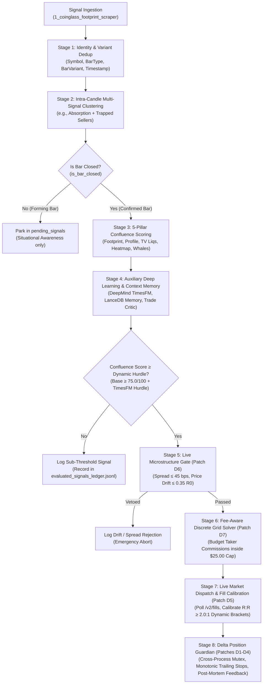

# Master SOP: End-to-End Real-Time Trading Signal Analysis & Execution Protocol

**Document ID**: `SOP-SIG-001`  
**Target Venue**: Delta Exchange India Exclusive authenticated REST API  
**Engine Reference**: `5_wake_on_footprint_signal.py` & `Terminal/realtime_signal_evaluator.py`  
**Status**: Production Standard (Integrated with Z.ai Institutional Patches D1–D9, W1–W2, S1, A1, C1, E1–E3, R1, and Hyperdash v2)

---

## 1. Executive Workflow Architecture

Every candidate market signal—whether generated from completed 15m time candles, discrete volume bars (100K, 250K, 5K contracts), or discrete range bars (Range 10, Range 200)—undergoes an automated 8-stage quantitative evaluation pipeline before touching live capital.

---

## 2. Step-by-Step Analysis Lifecycle

### Stage 1: Ingestion & Bar-Variant Identity Dedup
* **File**: `1_coinglass_footprint_scraper.py` & `Terminal/asset_signal_stack.py`
* **Protocol**:
  1. Footprint signals are harvested across 31 crypto instruments.
  2. The unique identity key incorporates the bar variant:
     $$\text{Signal Key} = (\text{symbol}, \text{bar\_type}, \text{bar\_variant}, \text{time\_ms})$$
     *Prevents collisions between Range 10 vs Range 200, and Volume 100K vs 250K vs 5K during high-volume bursts (`PATCH W1/S1/C1`).*
  3. Range and Volume bars are discrete, atomic events (`bar_closed = True`, true `close_time_utc`).

### Stage 2: Multi-Signal Candle Clustering
* **File**: `5_wake_on_footprint_signal.py`
* **Protocol**:
  1. Multiple footprint signals occurring on the *exact same candle variant* are grouped into a composite cluster.
  2. Co-occurring confluence events (e.g., **Absorption at Low** + **Trapped Shorts** + **CVD Divergence**) award a **+15 to +20 point cluster boost**.
  3. If a time-bar signal is in-flight (`is_bar_closed == False`), it is parked in `self.pending_signals` (`PATCH W2`) for continuous tracking and evaluated for execution only when the bar officially closes.

---

### Stage 3: The 5-Pillar Confluence Scoring Engine
* **File**: `Terminal/realtime_signal_evaluator.py`
* **Mathematical Weighting** (Base Score = 40.0 pts, Total Cap = 100.0 pts):

#### Pillar 1: Footprint & Order Flow Cluster (Max +25 pts)
* **Absorption / Trapped Participants**: Institutional absorption at swing highs/lows (+15 pts).
* **CVD Velocity Flow**: Alignment between Cumulative Volume Delta and trade direction (+10 pts).
* **Exhaustion / Divergence**: Depleted volume in the extreme 10% wick with directional reversal (+10 pts).

#### Pillar 2: Auction Profile & Value Areas (Max +20 pts)
* **Session VWAP Alignment**: Directional close defending Day VWAP / Prior Day VWAP (+10 pts).
* **Value Area Rejection**: Rejection from Value Area High (VAH) or Value Area Low (VAL) back into Value Area (+10 pts).
* **Fib-Prime Dynamic EMAs**: Directional defense of the dynamic ribbon (EMA 55, 59, 233) (+10 pts).

#### Pillar 3: Live CoinGlass TV Liquidations (Max +15 pts)
* **Blow-off Cascade Reversals**: Real-time TradingView liquidation spikes indicating capitulation tops/bottoms (+15 pts).
* **Exhaustion Turn**: Depletion of liquidation cascade volume (+10 pts).

#### Pillar 4: Liquidation Heatmap & Strike Magnets (Max +15 pts)
* **Near-Field Asymmetry**: Short/Long liquidation density ratio > 65% in favor of trade direction (+10 pts).
* **Overhead Short/Long Squeeze Fuel**: High-density liquidation pool located directly in the target profit path (+10 pts).
* **Hyperdash Whale Sweep Fuel (`PATCH E2`)**: Top-10 whale liquidation clusters 0.3%–5.0% ahead of price (+8 pts).
* **Stop-Zone Penalty**: Whale liquidation clusters 0.15%–1.2% behind entry inside stop zone (**-8 pt penalty**).

#### Pillar 5: Whales & Sweeps + Hyperdash Institutional Intel (Max +15 pts)
* **Hyperdash Smart Money Bias (`Terminal/hyperdash_intel_engine.py`)**:
  * Evaluates 347 markets $\times$ 11 cohorts (Apex, Extremely Profitable, Rekt, Shrimps).
  * Uses **disjoint cohort weighting** (Apex 3.0, Extremely Profitable 1.0, Very Profitable 0.3) and **trader headcount crowd bias** (Rekt 2.5, Unprofitable 1.5).
  * Smart Money Alignment (`smart_bias >= +15%` for Longs) $\rightarrow$ **+10 pts**.
  * Opposing Smart Money Distribution (`smart_bias <= -15%` against Longs) $\rightarrow$ **-15 pt penalty**.
  * Crowd Squeeze Detection (`CROWD_SQUEEZE_LONG` / `SHORT`) $\rightarrow$ **+10 pts**.

---

### Stage 4: Auxiliary Deep Learning & Context Memory
* **Files**: `Terminal/realtime_signal_evaluator.py`, `Database/Vector_Memory/`
* **Google DeepMind TimesFM 2.5 (200M)**:
  * Generates 128-horizon quantile CVD and price drift forecasts.
  * Adjusts dynamic execution hurdle: $\text{Hurdle} = 75.0 + \text{clip}(\text{TimesFM\_Hurdle}, 0.0, 10.0)$.
* **LanceDB Vector Memory**:
  * Semantic embedding of candidate market state via `bge-small-en-v1.5`.
  * Computes historical win-rate analogs from past trades (+10 pts for favorable regimes).
* **Trade Critic Post-Mortem Memory**:
  * Compares setup against `losing_trades_postmortem.lance`.
  * If candidate setup has $\ge 80\%$ similarity to a past recorded failure mode (e.g. `FALLING_KNIFE_LONG` or `HTF_MOMENTUM_RUNOVER`), applies an automatic **-25.0 pt critic penalty**!

---

### Stage 5: Live Microstructure & Venue Admission Gates (`PATCH D6`)
* **File**: `Terminal/delta_exchange_live_trader.py` (`validate_trade_geometry`)
* **Execution Gates**:
  1. **Venue Listing Gate**: Instrument must be actively listed on Delta Exchange India (`is_listed == True`).
  2. **Live Ticker Spread Gate**: Current mark/ask/bid spread must be strictly $\le 45\text{ bps}$ ($0.45\%$).
  3. **Stale Entry Drift Veto**: Live market mark price must not have drifted by more than $0.35 \times R_0$ from planned signal entry:
     $$|\text{Mark} - \text{Entry}_{\text{planned}}| \le 0.35 \times |\text{Entry}_{\text{planned}} - \text{SL}_{\text{planned}}|$$
     *Vetoes stale market orders on fast-moving tape (`STALE_ENTRY_PRICE_DRIFT`).*

---

### Stage 6: Fee-Aware Discrete Contract Grid Lot Sizing (`PATCH D7`)
* **File**: `Terminal/delta_exchange_live_trader.py` (`solve_fee_aware_grid`)
* **Mathematical Invariants**:
  * **Absolute Risk Cap**: Realized loss on stop-out $\le \$25.00\text{ USD}$ (`MAX_RISK_USD`).
  * **Taker Commission Inclusion**:
    $$\text{Loss Per Contract} = (|\text{Entry} - \text{SL}| + 2 \times \text{taker\_fee\_rate} \times \text{Entry}) \times \text{contract\_val\_usd}$$
  * **Discrete Lot Solver**:
    $$K = \left\lfloor \frac{\text{MAX\_RISK\_USD}}{\text{Loss Per Contract}} \right\rfloor$$
  * **Commission-Drag Guard**: Rejects trades where fees exceed $25\%$ of total stop risk (`COMMISSION_DRAG_REJECTED`).
  * **Margin Preservation Floor**: Free available margin buffer must remain $\ge 20.0\%$ universal floor.

---

### Stage 7: Live Order Dispatch & Dynamic $R:R \ge 2.0:1$ Fill Calibration (`PATCH D4 & D5`)
* **File**: `Terminal/delta_exchange_live_trader.py` (`reanchor_brackets_to_fill`)
* **Protocol**:
  1. Market order executed via authenticated Delta REST API under `delta_position_management.lock`.
  2. Actual fill price ($P_{\text{fill}}$) resolved via `/v2/fills` ledger polling (`confirm_market_fill`).
  3. Bracket Stop Loss and Take Profit are dynamically calibrated against $P_{\text{fill}}$:
     $$R_0 = |P_{\text{fill}} - \text{SL}_{\text{calibrated}}|$$
     $$\text{TP}_{\text{calibrated}} = P_{\text{fill}} \pm \max(2.0 \times R_0, |\text{TP}_{\text{magnet}} - P_{\text{fill}}|)$$
  4. **Widen-Only Ratchet**: If signal identified a high-probability liquidation magnet at $2.5R_0$ or $3.0R_0$, the TP is **never snapped back** to $2.0R_0$.

---

### Stage 8: Dynamic Trailing Stop Loss & Lifecycle Management
* **File**: `Terminal/delta_exchange_live_trader.py` (`trailing_stop_guardian_loop`)
* **Trailing Tiers**:
  * **Tier 1 ($+1.0 R_0$)**: Move SL to **Breakeven (+1 tick buffer)** once mark price reaches $+1.0 R_0$ profit. Risk is completely eliminated.
  * **Tier 2 ($+2.0 R_0$)**: Move SL to **lock $+1.0 R_0$ profit** and dynamically widen TP to $+3.0 R_0$.
  * **Tier 3 ($+3.0 R_0$)**: Move SL to **lock $+2.0 R_0$ profit**.
* **Post-Mortem Closed Loop**:
  * Every closed trade is audited by `TradeCriticEngine`.
  * Winning trades reinforce vector memory analogs.
  * Stopped-out trades are embedded into `Database/Vector_Memory/losing_trades_postmortem.lance` to inoculate the system against repeating the same failure pattern.

---

## 3. Signal Analysis Diagnostic Summary Matrix

| Evaluation Outcome | Score Range | Primary Causes | Action Taken |
| :--- | :--- | :--- | :--- |
| **EXECUTE_DELTA_SIGNAL** | $\ge 75.0$ (+ Hurdle) | Multi-pillar confluence, aligned CVD, whale sweep fuel, low spread ($\le 45\text{ bps}$), positive TimesFM hurdle. | Authenticated REST market dispatch, fill-anchored dynamic brackets armed, trailing guardian engaged. |
| **SUB_THRESHOLD_FILTERED** | $40.0 - 74.9$ | Weak order flow confirmation, opposing Smart Money bias, lack of liquidation magnet, or missing value area alignment. | Logged in `evaluated_signals_ledger.jsonl`; suppressed from live execution. |
| **CRITIC_VETO_REJECTED** | Any | Setup matches past failure mode ($\ge 80\%$ similarity to `FALLING_KNIFE_LONG` or `HTF_MOMENTUM_RUNOVER`). | -25 pt penalty applied; logged in audit ledger. |
| **MICROSTRUCTURE_VETO** | $\ge 75.0$ | Spread $> 45\text{ bps}$, price drift $> 0.35 R_0$, or ticker unavailable. | Emergency execution abort; prevents filling on adverse runaway tape. |
| **UNLISTED_ASSET** | Any | Symbol not tradable on Delta Exchange India (e.g. CRV, ATOM, ALGO). | Cleanly suppressed with zero API overhead. |
