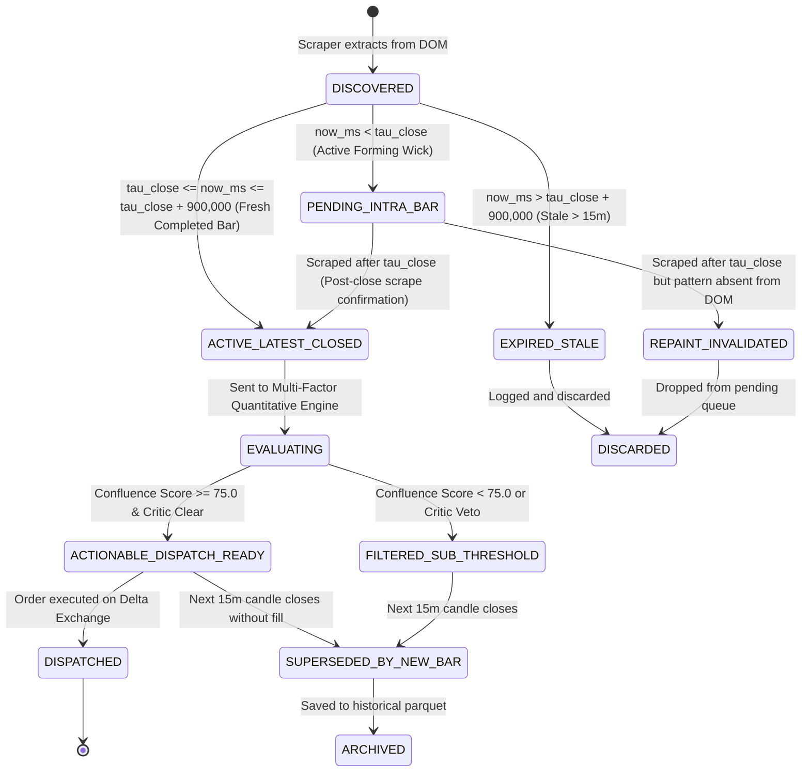

# Design Specification: Cross-Asset Signal Stack, Generational State Machine & Deterministic Deduplication

**Status:** Approved by Elephant Architect (Goldfish Audit Remediations Integrated)  
**Author:** Deep Context Architect (Elephant)  
**Date:** 2026-11-04  
**Target Subsystems & Actions:**
- `Create`: `Terminal/asset_signal_stack.py` (Core stack, deduplication ledger, priority arbiter)
- `Modify`: `Terminal/collector_lock.py` (Domain-isolated lock routing & TDMA lead-in buffers)
- `Modify`: `Terminal/matchtrader_live_trader.py` (Isolate live execution from scraper locks)
- `Modify`: `1_coinglass_footprint_scraper.py` (Respect lead-in TDMA, publish cluster attributes)
- `Modify`: `4_coinglass_tv_scraper.py` (Isolated TV lock, zero false contentions)
- `Modify`: `5_wake_on_footprint_signal.py` (Integrate stack, single-evaluation ledger, antecedent traversal)
- `Modify`: `Terminal/realtime_signal_evaluator.py` (Export `ev_300bar` in trade levels)
- `Create`: `Terminal/test_cross_asset_stack.py` (Comprehensive unit test suite)

---

## 1. Executive Summary & Problem Formulation

In a multi-asset quantitative trading system tracking 35+ perpetual contracts, footprint order-flow signals (e.g., Absorption, Trapped Traders, Exhaustion, CVD Divergence) are continuously discovered across staggered collection cycles.

### Observable Failure Modes in Production:
1. **Stale Historical Signal Resurfacing:** When scrapers navigate to an asset (e.g., `SOL`), the exchange/aggregator DOM renders historical signals across prior hours (e.g., signals from `00:56 IST` when current wall-clock time is `01:21 IST`). Without strict generational boundaries, Sentinel re-evaluates 25-minute-old setups, presenting obsolete alerts to the operator and risking execution on expired trade geometry.
2. **Lack of Global Cross-Asset Visibility:** Signals arrive asynchronously across distinct assets. Currently, each signal is evaluated in isolation without a centralized view of whether an asset's signal is *brand new*, *identical to an already processed signal*, or *superseded by a newer closed bar*.
3. **Repeated Review of Already Evaluated Bars:** When continuous scrapers re-sweep an asset, identical signals on the same completed candle are fed repeatedly into the evaluator, cluttering logs and causing duplicate evaluation passes.
4. **Browser Mutex Deadlocks & Starvation:** A monolithic `cdp_browser.lock` shared between 160-second footprint sweeps and fast 18-second TV liquidation sweeps creates continuous lock starvation (`SKIPPED_LOCK_CONTENTION`), causes Whale/Liquidation scrapers to miss 15-minute collection windows, and risks rejecting live MatchTrader orders.

This specification delivers the **Cross-Asset Generational Signal Stack (`AssetSignalStack`)**, providing mathematically guaranteed deduplication, multi-signal candle clustering, generational lifecycle tracking, reviewed-signal suppression with antecedent context traversal, and domain-isolated deadlock-free concurrency.

---

## 2. Generational Time Invariants & Canonical Key Formulation

### 2.1 Canonical 15-Minute Candle Quantization
All signal timestamps must align strictly to the fixed 15-minute epoch:
$$\tau_{\text{bar}} = \left\lfloor \frac{t_{\text{ms}}}{900,000} \right\rfloor \times 900,000$$
$$\tau_{\text{close}} = \tau_{\text{bar}} + 900,000$$

Where $t_{\text{ms}}$ is UTC epoch milliseconds.

### 2.2 Candle Cluster Key & Fingerprint (`CandleClusterKey`, `signal_id`)
To strictly preserve the **+15.0 to +20.0 point confluence boost** (`cluster_boost` in `Terminal/realtime_signal_evaluator.py`), multiple footprint signals occurring on the same candle (e.g. `Absorption` + `Trapped Shorts`) are clustered by candle rather than treated as competing records:

$$\text{CandleClusterKey} = \langle \text{symbol}, \tau_{\text{bar}} \rangle$$

The canonical signal fingerprint is:
$$\text{signal\_id} = \text{SHA256}(\text{symbol} + ":" + \text{str}(\tau_{\text{bar}}) + ":" + \text{direction} + ":" + \text{canonical\_sig\_codes})[:16]$$

Where:
- `symbol` is the uppercase asset ticker (e.g. `BTC`, `ETH`, `SOL`).
- $\tau_{\text{bar}}$ is the candle open timestamp in UTC milliseconds (multiple of 900,000).
- `direction` is `BUY` (bullish) or `SELL` (bearish).
- `canonical_sig_codes` is the sorted list of true CoinGlass signal codes (`abs`, `trap`, `exh`, `div`, `sdiv`).

*Invariant 1 (Idempotent Deduplication):* Ingesting a signal on an already evaluated or already registered candle cluster is a strict no-op (`DEDUPLICATED_SAME`). It will neither trigger re-evaluation nor punch duplicate orders.

---

## 3. Signal Generational State Machine

Every signal ingested into the pipeline transitions through an immutable state machine:

### 3.1 State Definitions:
1. **`PENDING_INTRA_BAR`**: Candle is actively forming ($t < \tau_{\text{close}}$). Stored in `Database/Signals/pending_wick_signals.json`; zero execution permitted.
2. **`ACTIVE_LATEST_CLOSED`**: The candle has closed ($t \ge \tau_{\text{close}}$) AND confirmed by an actual post-close scrape ($t_{\text{scrape}} \ge \tau_{\text{close}}$), and current wall-clock time is within the freshness window:
   $$\tau_{\text{close}} \le t_{\text{now}} \le \tau_{\text{close}} + 900,000\text{ ms}$$
   *Only signals in this state are eligible to act as an Evaluation Trigger and qualify for live order dispatch.*
3. **`REPAINT_INVALIDATED`**: A signal that was pending on an intra-bar wick, but upon post-close sweep is absent from CoinGlass `term.sigSets()`. Automatically invalidated and dropped.
4. **`SUPERSEDED_HISTORICAL`**: A newer closed candle has formed for this asset ($\tau_{\text{new}} > \tau_{\text{bar}}$). The older signal's state is preserved as historical context, but ceases to be actionable.
5. **`EXPIRED_STALE`**: A signal whose candle closed more than 15 minutes ago ($t_{\text{now}} - \tau_{\text{close}} > 900,000\text{ ms}$) upon initial ingest. Immediately flagged and discarded from the active execution stack.
6. **`DEDUPLICATED_SAME`**: Signal arrives with identical $\text{CandleClusterKey}$ to one already processed. Ignored.

---

## 3.2 Single Evaluation Invariant vs Antecedent Context Traversal

A core operational requirement stated by the operator:
> *"When we are evaluating current signal then we can review previous signals but review again reviewed signal must not happen."*

### Mathematical Protocol:
1. **Durable Evaluated Ledger (`Database/Signals/evaluated_signals_ledger.json`)**:
   Once any candle cluster $\langle \text{symbol}, \tau_{\text{bar}} \rangle$ finishes quantitative evaluation (regardless of whether it scored 85.0 or 45.0), its unique signature is durably persisted to `evaluated_signals_ledger.json`:
   $$\text{EvaluatedLedger} \leftarrow \text{EvaluatedLedger} \cup \{ \langle \text{symbol}, \tau_{\text{bar}} \rangle \}$$
   - Any future scrape containing $\langle \text{symbol}, \tau_{\text{bar}} \rangle$ is **strictly suppressed**. It will NEVER trigger another evaluation pass, alert card, or order attempt.
2. **Antecedent Signal Traversal (Read-Only Context)**:
   When evaluating a **NEW** signal on the current closed bar $\tau_{\text{bar}}$, Sentinel queries the asset's historical signals within a 3-hour lookback window:
   $$\mathcal{H}_{\text{signals}}(S) = \{ s \in \text{HistoricalSignals}(S) \mid \tau_{\text{bar}} - 10,800,000\text{ ms} \le s.\tau < \tau_{\text{bar}} \}$$
   - These preceding signals act strictly as **read-only structural confirmation** (e.g., confirming a 3-bar seller exhaustion $\rightarrow$ absorption $\rightarrow$ trapped shorts reversal sequence).
   - They provide $+5$ to $+15$ bonus confluence points if directionally aligned.
   - They **NEVER** fire an independent alert card or order. Zero double-counting, zero repeated evaluations.

---

## 4. Cross-Asset Signal Stack (`AssetSignalStack`) Architecture

The `AssetSignalStack` maintains an in-memory and atomically persisted matrix of the **latest signal state per asset** across all 35 instruments.

### 4.1 Schema (`active_signal_stack.parquet`):
Strictly adheres to repository standards (`AGENTS.md`) with primary Indian Standard Time (IST) columns:

| Column | Type | Description |
| :--- | :--- | :--- |
| `symbol` | `string` | Primary asset key (`BTC`, `ETH`, `SOL`, `LTC`, `ZEC`, etc.) |
| `signal_id` | `string` | Canonical 16-char hex fingerprint |
| `open_time_ist` | `string` | Primary IST candle open (`YYYY-MM-DD HH:MM:SS`) |
| `close_time_ist` | `string` | Primary IST candle close (`YYYY-MM-DD HH:MM:SS`) |
| `time_ist` | `string` | Primary IST timestamp alias (`YYYY-MM-DD HH:MM:SS`) |
| `candle_ist` | `string` | Primary IST candle format |
| `open_time_ist_ms` | `int64` | Canonical UTC open ms mapped for IST |
| `close_time_ist_ms` | `int64` | Canonical UTC close ms mapped for IST |
| `open_time_ms` | `int64` | Canonical UTC candle open epoch ms (compatible with `runtime_io.completed_candles`) |
| `close_time_ms` | `int64` | Canonical UTC candle close epoch ms (compatible with `runtime_io.completed_candles`) |
| `sig_name` | `string` | Composite pattern name (e.g. `Absorption + Trapped Shorts`) |
| `sig_code` | `string` | Comma-separated CoinGlass codes (`abs,trap`, `div`, etc.) |
| `cluster_signals_count` | `int32` | Number of signals co-temporal on this bar |
| `direction` | `string` | `BUY` or `SELL` |
| `price` | `float64` | Footprint signal trigger price |
| `confluence_score` | `float64` | Multi-factor quantitative score (0.0 to 100.0) |
| `ev_300bar` | `float64` | 300-bar empirical expectancy (in R multiples, exported by evaluator) |
| `rr_ratio` | `float64` | Trade geometry Reward-to-Risk ratio |
| `state` | `string` | `ACTIVE_LATEST_CLOSED`, `SUPERSEDED`, `FILTERED`, `DISPATCHED` |
| `is_new_candle` | `bool` | True if this candle index was never previously seen for this symbol |
| `delta_product` | `string` | Resolved Delta Exchange symbol (e.g. `SOLUSD`, `ZECUSD`, or `N/A`) |
| `updated_at_ist` | `string` | Primary IST timestamp of state update |

### 4.2 Cross-Asset Priority Arbiter
When multiple assets discover `ACTIVE_LATEST_CLOSED` signals at the identical 15-minute epoch:
1. **Hold Window (Synchronization Barrier)**: Sentinel implements a 90-second hold window after $\tau_{\text{close}}$ to allow sequential scraper sweeps across all 35 assets to complete before ranking.
2. **Mandatory Expectancy Gate**: Candidates must have $\text{EV}_{\text{300bar}} \ge 0.0$ and $\text{Confluence Score} \ge 75.0$.
3. **Clamped R:R Ratio**: $R:R$ is clamped to $[1.5, 4.0]$:
   $$\text{RR}_{\text{clamped}} = \min(4.0, \max(1.5, \text{R:R}))$$
4. **Normalized Ranking Score**:
   $$\text{RankScore} = 0.70 \times \text{Confluence} + 0.15 \times \left(\frac{\text{RR}_{\text{clamped}} - 1.5}{2.5} \times 100\right) + 0.15 \times \left(\min(1.0, \max(0.0, \text{EV}_{\text{300bar}})) \times 100\right)$$
5. **Delta Product Resolution**: Reject any candidate where `resolve_product(sym) is None`.
6. **Trade Critic Veto**: Reject candidates triggering `HARD_VETO`.
7. **Strict Risk Floor & Position Limits**:
   - Live order dispatch is strictly bounded by `MAX_OPEN_POSITIONS = 2` across all venues. Zero free cash capacity bypass.
   - Sizing capped at `MAX_RISK_USD = 25.00`.
8. **In-Flight Order Execution Lock**: Live execution wraps order dispatch inside:
   `with FileMutex(LOCK_DIR / "order_execution_inflight.lock", timeout=15.0)` to pause WARP IP rotation during dispatch.

---

## 5. Deadlock-Free Concurrency & File System Protections

### 5.1 Domain-Isolated Browser Locks
To eliminate the architectural deadlock where 160-second footprint sweeps starve TV liquidations and live MatchTrader order execution:
- `BrowserLock` dynamically routes each collector to its **own dedicated lock**:
  - `TVLiquidationScraper` $\rightarrow$ `Database/.locks/cdp_tv_scraper.lock`
  - `FootprintScraper` $\rightarrow$ `Database/.locks/cdp_footprint.lock`
  - `WhaleScraper` $\rightarrow$ `Database/.locks/cdp_whales.lock`
  - `LiquidationScraper` $\rightarrow$ `Database/.locks/cdp_liquidation.lock`
  - `MatchTraderLiveExecution` $\rightarrow$ `Database/.locks/matchtrader_execution.lock`
- MatchTrader live execution is **completely isolated** from CoinGlass scrapers. Order execution never blocks on CoinGlass CDP activity.

### 5.2 Two-Tier TDMA Lead-In Deconfliction
To prevent 120s–160s Footprint sweeps from overrunning into reserved Whale (:00, :15, :35, :50) or Liquidation (:10, :25, :55) windows:
- Add a **2-minute lead-in reservation**:
  - `WHALE_RESERVED_MINUTES = [58, 59, 0, 1, 13, 14, 15, 16, 33, 34, 35, 36, 48, 49, 50, 51]`
  - `LIQUIDATION_RESERVED_MINUTES = [8, 9, 10, 11, 12, 23, 24, 25, 26, 27, 53, 54, 55, 56, 57]`
- Footprint scraper yields if the current minute is within 2 minutes of a Whale or Liquidation window.

### 5.3 Lock-Free Atomic Persistence & Replay Safety
1. All parquet updates use `Terminal/runtime_io.atomic_parquet` with Windows exponential backoff retry.
2. Forming intra-bar signals are buffered in `Database/Signals/pending_wick_signals.json`, allowing the main stream byte offset (`Database/.wake_on_footprint_state.json`) to advance without losing forming signals across restarts.
3. Historical replays run with `set_live_dispatch(False)` (`DRY_RUN_REPLAY`).

---

## 6. Verification & Acceptance Criteria

1. **Deadlock Elimination Test:** Running Footprint scraper and TV scraper concurrently must yield **zero** `SKIPPED_LOCK_CONTENTION` events.
2. **Reviewed-Signal Suppression Test:** Injecting identical closed signals for `SOL` 10 times consecutively must yield exactly 1 evaluation in `evaluated_signals_ledger.json` and 0 duplicate alert cards or orders.
3. **Antecedent Traversal Test:** Evaluating a new `SOL` signal at $T=01:15$ must inspect the preceding $T=01:00$ `SOL` signal as passive read-only context without re-evaluating the $01:00$ bar.
4. **Candle Cluster Confluence Test:** Simultaneous `abs` and `trap` signals on `SOL` at $T=01:15$ must cluster into a single evaluation with `cluster_boost` applied (+15 pts).
5. **Multi-Asset Ranking Test:** Simultaneous alerts on `BTC` (score 78.0) and `SOL` (score 88.0) must prioritize `SOL` for Delta dispatch within `MAX_OPEN_POSITIONS = 2`.
