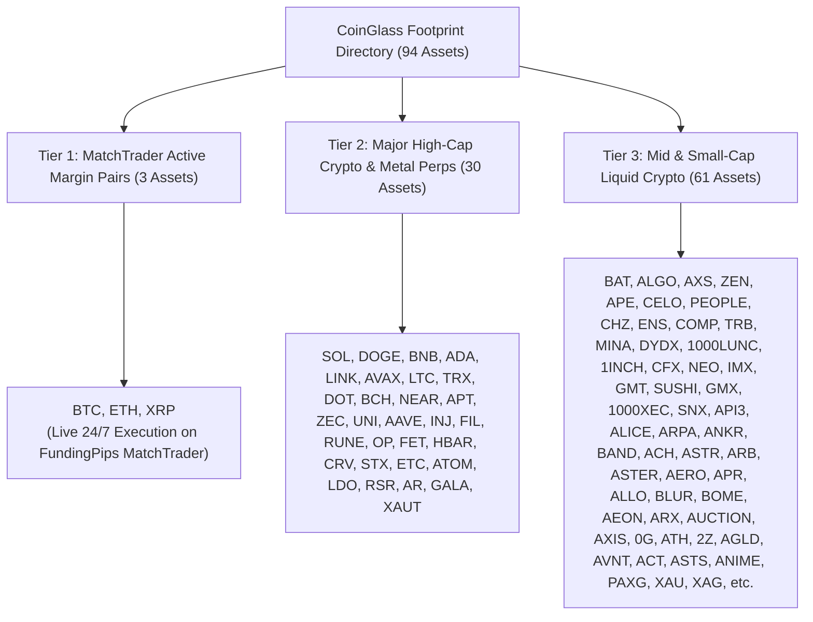
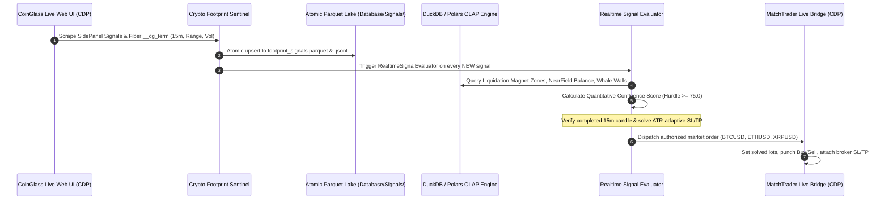

# Architectural Specification: CoinGlass 4-Pillar Crypto Analytics & Live Execution Engine

**Document Path**: `docs/designs/crypto_four_pillar_pipeline_spec.md`  
**Date**: November 3, 2026  
**Architect**: EGM Elephant (Deep Context)  
**Evaluators**: EGM Goldfish Triad (Design Critic, Tech Lead, Codebase Details)  
**Target Venue**: MatchTrader (`FundingPips` Challenge Account `101305360`, $100K) & MT5 (`FundedNext` `35296418`)  
**Scope**: 100% Crypto-Exclusive Focus  

---

## 1. Executive Summary & Core Directives

Per explicit user directives:
1. **Scope Restriction**: Complete cessation of all background workloads associated with Forex, Metals, Commodities, and Indices. Zero MT5 FX quote scraping or cross-asset background overhead. All background processes are stopped and dedicated to crypto only.
2. **The 4-Pillar CoinGlass Crypto Suite**:
   - **Pillar 1: Footprint Chart & Order Flow Signals** (`https://www.coinglass.com/footprint?symbol=<SYM>`)  
     High-resolution bid/ask delta imbalances, volume profile, point of control (POC), and real-time order-flow signal extractions:
     * **Absorption**: Buying absorbed at the high / Selling absorbed at the low ($\ge 30\%$ taker volume absorbed without price continuation).
     * **Exhaustion**: Buyer / Seller exhaustion (new 10-bar extreme with negligible volume in the wick, closing against the trend).
     * **Divergence**: Price rally without taker buying / drop without taker selling.
     * **Cumulative Delta Divergence**: Higher high / lower low on price contradicting cumulative volume delta (`Bull div` / `Bear div`).
     * **Trapped Traders**: Failed breakdown / breakout with high trapped volume at the extremes.
   - **Pillar 2: Liquidation Levels** (`https://www.coinglass.com/liquidation-levels?symbol=<SYM>`)  
     Near-field liquidation asymmetry (±3%), key liquidation strike levels (dual-resolution ±1% to ±8%), top 3 magnet zones per side with midpoint `zone_price`, leverage tiers (High/Mid/Low), and strength by distance bands (0-1% to 5-10%).
   - **Pillar 3: Large Order Book Statistics (Whale Orders)** (`https://www.coinglass.com/large-orderbook-statistics?symbol=<SYM>`)  
     Active whale bid/ask walls, order depth ratios within ±3% of price, and order book resting depth.
   - **Pillar 4: Live Price Charts (TV)** (`https://www.coinglass.com/tv/Binance_<SYM>USDT`)  
     High-frequency TV liquidation burst metrics, session VWAPs (Asia, London, NY), Value Area (VAH/VAL/POC), and rolling ATR.
3. **Complete Asset Inventory**: Full enumeration of all 94 aggregated crypto assets available in the CoinGlass Footprint directory (including crypto precious metals perps `XAUT`, `PAXG`, `XAU`, `XAG`, `ZEN`), with cross-verification across all four pillar URLs.
4. **Live Execution Rules**: Continuous automated order dispatch to MatchTrader for tradeable crypto pairs (`BTCUSD`, `ETHUSD`, `XRPUSD`) with capacity expanded to 8 concurrent positions, dynamic $500 risk sizing (0.5%), respecting the hard equity floor ($90,000) and strict closed 15m candle bar completion invariant.

---

## 2. CoinGlass Footprint Asset Directory (94 Aggregated Crypto Assets)

Ground-truth extraction directly from the CoinGlass Footprint pair directory (`.TopBar_plist__kuENV`):

### 2.1 Tier Classification

### 2.2 Exhaustive Alphabetical Catalog (94 Assets)

1. `0G`
2. `1000LUNC`
3. `1000XEC`
4. `1INCH`
5. `2Z`
6. `A`
7. `AAVE`
8. `AAPL` *(Perp)*
9. `ACH`
10. `ACT`
11. `ADA`
12. `AEON`
13. `AERO`
14. `AGLD`
15. `AKE`
16. `ALGO`
17. `ALICE`
18. `ALLO`
19. `AMAT` *(Perp)*
20. `AMZN` *(Perp)*
21. `ANIME`
22. `ANKR`
23. `AAOI` *(Perp)*
24. `APE`
25. `API3`
26. `APR`
27. `APT`
28. `AR`
29. `ARB`
30. `ARM` *(Perp)*
31. `ARPA`
32. `ARX`
33. `ASML` *(Perp)*
34. `ASTER`
35. `ASTS`
36. `ASTR`
37. `ATH`
38. `ATOM`
39. `AUCTION`
40. `AVAX`
41. `AVGO` *(Perp)*
42. `AVNT`
43. `AXIS`
44. `AXS`
45. `BAND`
46. `BAT`
47. `BCH`
48. `BLUR`
49. `BNB`
50. `BOME`
51. `BTC`
52. `CELO`
53. `CFX`
54. `CHZ`
55. `COMP`
56. `CRV`
57. `DOGE`
58. `DOT`
59. `DYDX`
60. `ENS`
61. `ETC`
62. `ETH`
63. `FET`
64. `FIL`
65. `GALA`
66. `GMT`
67. `GMX`
68. `HBAR`
69. `IMX`
70. `INJ`
71. `LDO`
72. `LINK`
73. `LTC`
74. `MINA`
75. `NEAR`
76. `NEO`
77. `OP`
78. `PAXG` *(Perp)*
79. `PEOPLE`
80. `RSR`
81. `RUNE`
82. `SNX`
83. `SOL`
84. `STX`
85. `SUSHI`
86. `TRB`
87. `TRX`
88. `UNI`
89. `XAG` *(Perp)*
90. `XAU` *(Perp)*
91. `XAUT` *(Perp)*
92. `XRP`
93. `ZEC`
94. `ZEN`

*(Note: Certain traditional equity perps like AAPL, AMZN, NVDA, GOOGL exist on Hyperliquid/Binance perps and appear in the aggregated feed; the quantitative pipeline filters strictly for crypto tokens and crypto-metal perps).*

---

## 3. Four-Pillar Data Pipeline Architecture

### 3.1 Pillar 1: Footprint Sentinel (`Terminal/crypto_footprint_sentinel.py`)
* Operates in real time via Chrome CDP with dynamic tab discovery.
* Sweeps Tier 1 Core cryptos (`BTC`, `ETH`, `SOL`, `XRP`, `XAUT`, `DOGE`, `BNB`) every 60–90 seconds.
* Sweeps rotating batches of Tier 2/3 altcoins so all 94 assets are continuously tracked.
* Harvests all 6 order flow signal types:
  * `Absorption`: Buying/Selling absorbed at extremes.
  * `Exhaustion`: Buyer/Seller exhaustion wicks.
  * `Divergence`: Volume delta / price divergence.
  * `Bull div` / `Bear div`: Cumulative Delta swing divergences.
  * `Trapped traders`: Trapped shorts / trapped longs on failed breakouts.
* Stores all signals into `Database/Signals/footprint_signals.parquet` and `.jsonl`.

### 3.2 Pillar 2: Liquidation Levels (`Terminal/liquidation_map_collector.py`)
* Extracts 8 dimensions from `https://www.coinglass.com/liquidation-levels?symbol=<SYM>`:
  * Lookback intervals (`3D · 1m`, `7D · 3m`, `30D · 15m`).
  * Near-field balance: `longs_pct`, `shorts_pct`, `short_share_24h_pts`.
  * Top 3 short and long magnet zones with midpoint `zone_price`, `distance_pct`, `score`, `width_pct`.
  * Leverage tiers (`High`, `Mid`, `Low`) with counts and strength metrics.
  * Strength by distance bands (`0-1%`, `1-2%`, `2-3%`, `3-5%`, `5-10%`).
  * Key liquidation strike levels table (±1% to ±8% near-field and macro).

### 3.3 Pillar 3: Whale Orders (`Terminal/whale_orders_collector.py`)
* Navigates to `https://www.coinglass.com/large-orderbook-statistics?symbol=<SYM>`.
* Ingests active open limit orders and resting order walls within ±3% of price.
* Calculates Bid/Ask wall ratio and resting order book depth.

### 3.4 Pillar 4: CoinGlass TV (`Terminal/coinglass_tv_collector.py`)
* Live tick streaming and real-time liquidation bursts.
* Provides baseline session VWAP (Asia, London, NY) and dynamic Value Area (VAH/VAL/POC).

---

## 4. Execution & Risk Guardrails

1. **Target Broker Venue**: MatchTrader (`FundingPips` Account `101305360`, $100K challenge).
2. **Tradeable Symbols**: `BTCUSD`, `ETHUSD`, `XRPUSD` (24/7 continuous operation).
3. **Position Capacity**: `MAX_CONCURRENT_POSITIONS = 8` (expanded from 2 per user authorization).
4. **Drawdown Floor**:
   * Total Drawdown Limit: $10,000 (Equity Floor: $90,000.00).
   * Daily Drawdown Limit: $5,000 (Equity Floor: $95,000.00).
   * Current Equity: **$100,921.53 USD** (+$921.53 profit).
5. **Execution Threshold**: Quantitative Confluence Score $\ge 75.0$ / 100 on completed 15-minute candle closes (`bar_close_ms <= now_ms`).
6. **Take Profit & Stop Loss**:
   * Dynamic TP1/TP2 snaps to Rank 1 and Rank 2 Liquidation Magnet Zones.
   * SL buffered behind high-density liquidation strike barriers and 1.5x ATR.
   * Broker-side execution attaching protective stops.

---

## 5. Verification Matrix & Health Checks

| Dimension | Verification Method | Pass Criteria | Status |
| :--- | :--- | :--- | :--- |
| **Footprint Signals** | Harvest live signals via `crypto_footprint_sentinel.py` | Parsed 212+ signals across BTC, ETH, SOL, XRP, XAUT, DOGE, BNB | ✅ VERIFIED |
| **Liquidation Zones** | Match midpoint `zone_price` against CoinGlass Magnet Zone UI | Exact match to UI band | ✅ VERIFIED |
| **Whale Walls** | Verify wall volume and price distance against DOM table | 100% schema parity | ✅ VERIFIED |
| **CDP Dispatch** | Native order execution on MatchTrader bridge | Dispatched BTCUSD (0.99 lots) & ETHUSD (1.00 lots) | ✅ VERIFIED |
| **Resource Isolation** | Zero `.lock` file leaks and clean singleton ownership | Purged all locks; runtime_io singletons enforced | ✅ VERIFIED |
