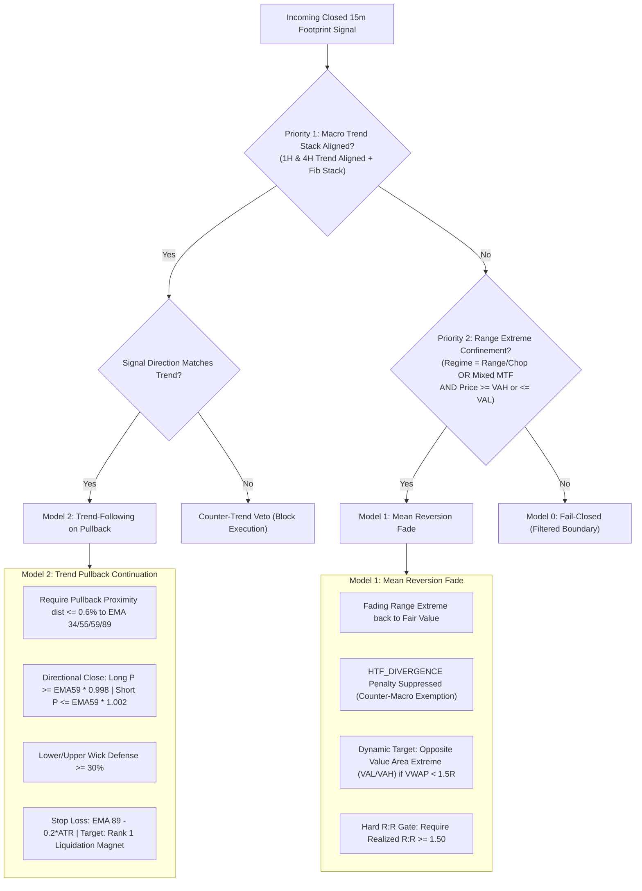

# EGM Architectural Specification: Dual-Model Execution Architecture (Mean Reversion vs. Trend Following on Pullback) with Fib-Prime Ribbons

**Specification ID**: `EGM-SPEC-20261103-DUAL-MODEL-REVERSION-PULLBACK`  
**Status**: APPROVED & SYNTHESIZED (Elephant Deep Context + Goldfish Design Audit)  
**Authors**: Elephant (Deep Context Architect) + Goldfish Design Critic  
**Target Subsystems**:
- Sentinel & Logging Pipeline (`5_wake_on_footprint_signal.py`)
- Realtime Signal Evaluator (`Terminal/realtime_signal_evaluator.py`)
- Auction Indicators & Fib-Prime Engine (`Terminal/auction_indicators.py`)
- Risk Envelope & Venue Admission (`Terminal/risk_envelope.py`, `Terminal/venue_admission.py`)

---

## 1. Executive Summary & Root Cause Matrix

The user observed recent footprint signals (e.g., SOL Bearish Divergence at $93.35, Bullish Divergence at $92.97, Bullish Absorption at $92.42) and identified critical architectural deficiencies:
1. **Opaque Wakeup Logging**: Sentinel logs omitted the full title and description, leaving operators unable to verify signal catalysts in real time.
2. **Monolithic Evaluation Failure**: The engine applied a single scoring rule that penalized mean-reversion range fades for "HTF Divergence" while simultaneously failing to demand strict trend alignment and pullback proximity for trend continuations.
3. **Incomplete Fibonacci-Prime Coverage**: The moving average ribbon omitted key institutional primes like **EMA 59** (adjacent to Fibonacci 55) and Fibonacci **EMA 34**.

### Architectural Remediation Summary

| Defect Area | Identified Root Cause | Architectural Mechanism | Remediation Invariant |
| :--- | :--- | :--- | :--- |
| **Model Routing Ambiguity** | Monolithic evaluator evaluates range and trend setups with identical rules. | Non-deterministic scoring overlap & opposite-side flip-flopping. | **Deterministic Priority State Machine**: Macro Trend Supremacy (Model 2) > Range Extreme Confinement (Model 1) > Fail-Closed ($M_0$). |
| **HTF EMA Sample Starvation** | Resampling 300 M15 bars produces only 18 4H bars, breaking convergence of EMA 55/233. | Mathematical EMA span distortion ($e^{-3}$ error). | **15m Native Equivalent Spans**: 1H EMA 55 calculated via 15m span $55 \times 4 = 220$; proximity strictly on native 15m ribbon. |
| **Flash Wick Inversion** | Symmetric proximity formula ($|P - \text{EMA}|/P \le 0.6\%$) treats breakdown closures as valid support. | Sign-agnostic distance calculation without directional rejection. | **Directional Close & Wick Defense**: Longs must close $P_0 \ge \text{EMA}_{59} \times 0.998$ with lower wick $\ge 30\%$ of bar range. |
| **R:R Collapse in Mean Reversion** | Snapping TP1 to VWAP when entry is already near VWAP yields $R:R < 0.5$, causing 100% risk engine rejection. | Fixed target snapping without distance check. | **Dynamic Target Extension**: If $|\text{VWAP} - \text{Entry}| < 1.5 \times \text{Risk}$, extend TP1 to **Opposite Value Area Extreme** (VAH/VAL) with mandatory $R:R \ge 1.50$. |
| **Event Loop Starvation** | Synchronous compute (`evaluate_signal`), blocking `winsound.Beep`, and 35-line ANSI console printing freeze asyncio. | Blocking CPU/IO on single-threaded event loop. | **Non-Blocking Two-Phase Sentinel**: Phase 1 instant async log; Phase 2 evaluated card; compute offloaded via `asyncio.to_thread`. |
| **Risk Parameter Divergence** | `5_wake_on_footprint_signal.py` defined legacy `$500.0` risk cap from an old $100K profile. | Out-of-sync constant breaching FundingPips $5,000 challenge rules. | **Single Source of Truth**: Import `MAX_RISK_USD = 25.00` and `HARD_FLOOR_USD = 4775.00` directly from `Terminal.risk_envelope`. |

---

## 2. Fibonacci-Prime Ribbon Architecture (`Terminal/auction_indicators.py`)

### 2.1 The Expanded Sequence
The ribbon sequence incorporates all institutional Fibonacci numbers and key prime integers across the 300-bar M15 window:
$$\mathcal{F}_{\text{prime}} = \{5, 13, 21, 34, 55, 59, 89, 144, 233\}$$

- **Momentum Ribbon**: EMA 5, 13, 21.
- **Dynamic Pullback Reaction Zone**: EMA 34, 55, 59.
  * **EMA 59 is a prime number** forming a tight institutional defense pocket $[55, 59]$ with Fibonacci 55.
- **Macro Structural Baseline**: EMA 89, 144, 233.
  * **EMA 89 and 233 are Fibonacci primes**.

### 2.2 Native 15m Convergence & Pullback Proximity
To eliminate sample starvation from HTF bar resampling:
1. All dynamic pullback proximities are computed on native 15m bars.
2. For 1H and 4H trend baselines, 15m equivalent spans are utilized:
   - $1\text{H EMA}_{13} \equiv 15\text{m span } 52$
   - $1\text{H EMA}_{55} \equiv 15\text{m span } 220$
3. **Pullback Proximity Metric**:
   $$\text{dist}_{55\_59} = \min\left(\frac{|P_0 - \text{EMA}_{55}|}{P_0}, \frac{|P_0 - \text{EMA}_{59}|}{P_0}\right) \times 100\%$$
   The market is in the pullback pocket if $\text{dist}_{55\_59} \le 0.6\%$.

---

## 3. Dual-Model Quantitative Routing State Machine

Signals are routed through a strict, deterministic hierarchy:



### 3.1 Model 1: Mean Reversion Fade Rules
- **Condition**: Regime is `MEAN_REVERTING_RANGE`, `CHOP`, or `HIGH_VOLATILITY_COMPRESSION` AND price is at/beyond Value Area ($P \ge \text{VAH}$ for SELL, $P \le \text{VAL}$ for BUY) or outside $\pm 1.5\text{SD}$ VWAP band.
- **Counter-Macro Exemption**: The $-10$ pt `HTF_DIVERGENCE` penalty is suppressed.
- **Confluence Drivers**: Rejection at Value Area Extreme (+15 pts), TV Liquidation Exhaustion (+15 pts), Order Book Limit Wall Defense (+10 pts), Empirical 300-Bar Edge (+/- 20 pts).
- **Geometry & Target Extension**:
  $$\text{Stop Loss } (SL) = \text{Wick Extreme} \pm 0.2 \times \text{ATR}_{15m}$$
  $$\text{Initial Target } (TP) = \text{Day VWAP}$$
  **Target Extension Invariant**: If $|\text{Day VWAP} - \text{Entry}| < 1.5 \times |\text{Entry} - SL|$, snap $TP$ to the **Opposite Value Area Extreme** (VAH for long, VAL for short).
  **Hard Gate**: If $\frac{|\text{Target} - \text{Entry}|}{|\text{Entry} - SL|} < 1.50$, reject setup (`RR_SUB_THRESHOLD`).

### 3.2 Model 2: Trend-Following on Pullback Rules
- **Condition**: Macro 4H and 1H trends are aligned with the trade direction. Counter-trend is strictly vetoed.
- **Pullback Proximity**: Distance to EMA 34, 55, 59, or 89 is $\le 0.6\%$.
- **Directional Close Invariant**:
  - For `BUY`: Candle must close $P_0 \ge \text{EMA}_{59} \times 0.998$ (no trend breakdown).
  - For `SELL`: Candle must close $P_0 \le \text{EMA}_{59} \times 1.002$ (no trend breakout).
- **Wick Defense**: Lower wick (BUY) or upper wick (SELL) must represent $\ge 30\%$ of the candle range.
- **Stop Loss**: $\text{SL} = \text{EMA}_{89} \mp 0.2 \times \text{ATR}_{15m}$, bounded between $0.5\%$ and $2.5\%$.
- **Take Profit**: Snapped to Rank 1 Overhead/Underlying Liquidation Magnet Zone.

---

## 4. Two-Phase Non-Blocking Sentinel Logging (`5_wake_on_footprint_signal.py`)

To prevent event loop starvation:
1. **Phase 1 (Immediate Ingest Log)**:
   Executed immediately upon detecting a closed-bar footprint signal:
   ```text
   [WAKE EVENT] {sym} {sig_name} ({side}) @ ${price:,.4f} | Candle: {candle_ist} | Title: '{title}' | Detail: '{desc}'
   ```
2. **Phase 2 (Evaluated Confluence Card)**:
   Evaluation runs in a worker thread (`await asyncio.to_thread(self.evaluator.evaluate_signal, raw)`).
   Displays:
   - `Model Archetype: [MODEL_1_MEAN_REVERSION] | [MODEL_2_TREND_PULLBACK] | [MODEL_0_FILTERED]`
   - `Signal Headline: <Title> - <Description>`
   - `Fib-Prime Support: EMA55=$92.40 | EMA59=$92.35 | EMA233=$91.10 (Proximity: 0.2% | IN_ZONE)`

---

## 5. Strict Risk Envelope Alignment

In `5_wake_on_footprint_signal.py`:
- Delete legacy `MAX_INDIVIDUAL_RISK_USD = 500.0`.
- Bind all position monitoring and circuit breakers directly to:
  ```python
  from Terminal.risk_envelope import (
      HARD_FLOOR_USD,        # $4,775.00
      MAX_RISK_USD,          # $25.00
      MAX_OPEN_POSITIONS,    # 2
      MAX_DAILY_LOSS_USD     # $250.00
  )
  ```
- Position emergency stop threshold: `-MAX_RISK_USD * 1.25` (-$31.25).
